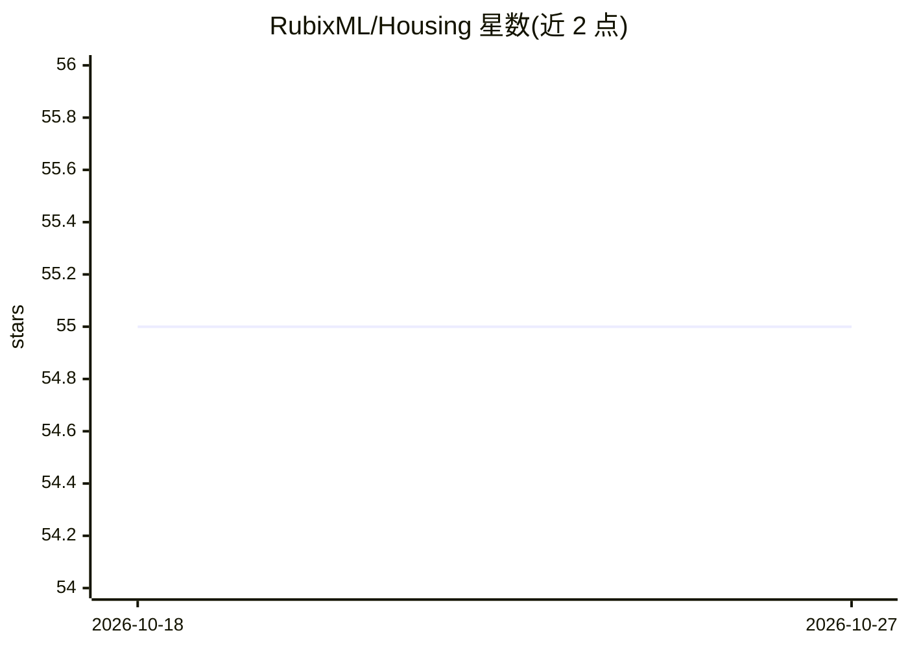

# RubixML/Housing

⭐ 55 · PHP · MIT · 推送 2026-10-08 · [GitHub](https://github.com/RubixML/Housing) · [官网](https://rubixml.github.io/ML) · 组织维护

**Rubix ML 示例项目：用梯度提升机预测房价并提交 Kaggle**

基于 Rubix ML 库的 PHP 示例教程项目：使用 Ames 房价数据集（1,460 个有标签样本、79 个特征），以 Gradient Boost（GBM，回归树作为 booster）训练回归模型，预测未知样本售价并导出 CSV 供 Kaggle 竞赛提交。内容覆盖 CSV 提取、缺失值填充、Binned Split 分层划分、验证集早停、模型持久化与推理。通过 composer create-project 安装，要求 PHP 8.3 以上，推荐 Tensor 4.1+ 扩展加速训练。

## 筛选速览

| 维度 | 判定 | 备注 |
|---|---|---|
| AI 角色 | `ai-native` | 本体是模型或模型工具 |
| 许可风险 | `permissive` | MIT |
| 部署形态 | `None` |  |
| 模型依赖 | — | README 未给出锁定关系 |
| 硬件要求 | — | 无带数字的原话,不猜 |
| 安装摩擦 | `low` | 无编译、无系统依赖或容器化 |
| 成熟度 | — | 结构信号不足 |

## 能力要点

- Gradient Boost 回归模型与回归树 booster 的完整训练流程
- Binned Split 按标签分箱分层划分训练/验证集
- 验证集评分驱动的早停与最佳快照恢复
- Persistent Model 持久化与 predict.php 推理导出

## 适用场景

- 学习如何在 Rubix ML 中完成回归任务
- 参加 Kaggle 房价竞赛并生成提交文件
- 参考 GBM 训练、验证与持久化的 PHP 代码模板

## 场景标签

`教程课程` · 领域:学习与行业

## 证据(README 行号)

> L3: An example Rubix ML project that predicts house prices using a Gradient Boosted Machine (GBM) and a popular dataset 
> L30: Kaggle is a platform that allows you to test your data science skills by engaging with contests. This tutorial is d

## 星数曲线

2026-10-18 55 → 2026-10-27 55（+0）

---
*卡片 v1 · prompt 1.4 · 生成 2026-10-24 · 置信度 high · 依据 README sha `70fb6ede2470` · [字段定义](../../DATASET.md)*
