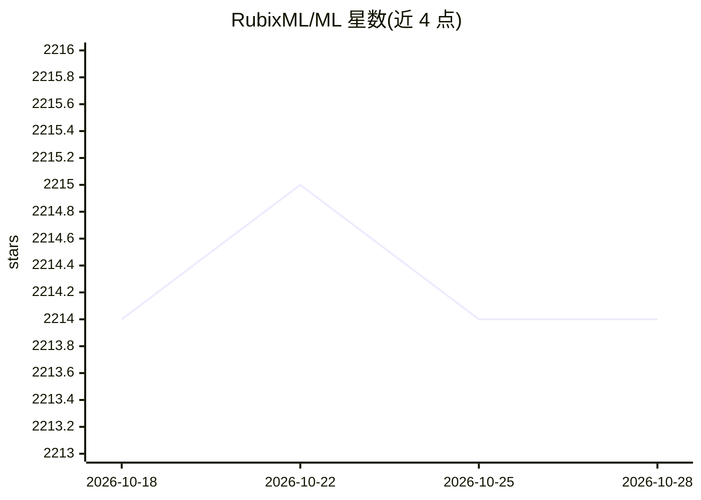

# RubixML/ML

⭐ 2,214 · PHP · MIT · 推送 2026-10-21 · [GitHub](https://github.com/RubixML/ML) · [官网](https://rubixml.org) · 组织维护

**PHP 机器学习/深度学习库，覆盖完整 ML 生命周期**

面向 PHP 开发者的机器学习与深度学习库，提供 40 余种有监督与无监督学习算法，工具链覆盖 ETL、预处理、交叉验证、训练到生产部署全流程。要求 PHP 8.3 以上，推荐安装 Tensor 扩展 4.1+ 加速矩阵/向量计算，另有 Swoole 多进程、GD 图像、libsvm 等可选扩展。通过 Composer 安装，附教程与 CIFAR-10、MNIST、情感分析等 13 个示例项目；代码 MIT 许可，文档 CC BY-NC 4.0。

## 筛选速览

| 维度 | 判定 | 备注 |
|---|---|---|
| AI 角色 | `ai-native` | 本体是模型或模型工具 |
| 许可风险 | `permissive` | MIT |
| 部署形态 | `None` |  |
| 模型依赖 | — | README 未给出锁定关系 |
| 硬件要求 | — | 无带数字的原话,不猜 |
| 安装摩擦 | `medium` | 含编译或系统依赖之一 |
| 成熟度 | — | 结构信号不足 |

## 能力要点

- 40 余种有监督与无监督学习算法
- 覆盖 ETL、预处理、交叉验证与生产部署全周期
- Tensor 扩展加速矩阵/向量计算，多组可选 PHP 扩展
- 提供 13 个从入门到进阶的示例项目

## 适用场景

- 在 PHP 项目中训练分类、回归、聚类与异常检测模型
- 构建图像识别或文本情感分析等应用
- 从数据处理到训练验证一站式完成 ML 流程

## 场景标签

`模型训练` `MLOps` · 领域:训练与推理

## 证据(README 行号)

> L5: A high-level machine learning and deep learning library for the PHP language.
> L57: Rubix ML is a free open-source machine learning (ML) library that allows you to build programs that learn from your

## 星数曲线

2026-10-18 2,214 → 2026-10-28 2,214（+0）

---
*卡片 v1 · prompt 1.4 · 生成 2026-10-21 · 置信度 high · 依据 README sha `4e86b23ce45b` · [字段定义](../../DATASET.md)*
