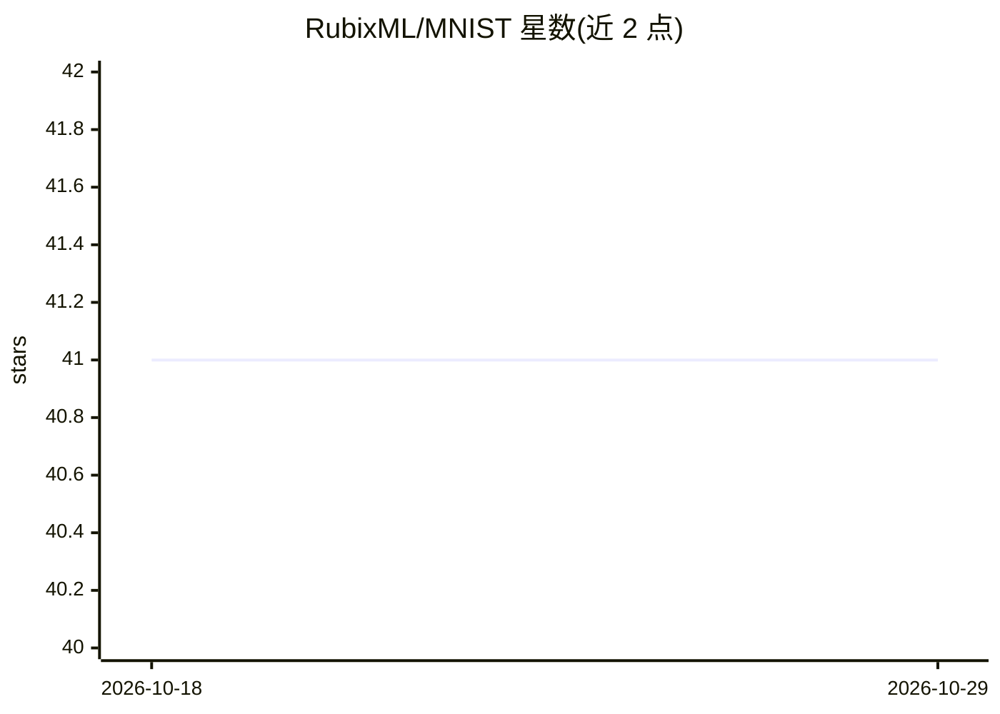

# RubixML/MNIST

⭐ 41 · PHP · MIT · 推送 2026-10-08 · [GitHub](https://github.com/RubixML/MNIST) · [官网](https://rubixml.github.io/ML) · 组织维护

**用 Rubix ML 训练多层感知机识别 MNIST 手写数字的教程项目**

基于 PHP 机器学习库 Rubix ML 的教学项目：使用 6 层 Multilayer Perceptron（Dense+GELU+Dropout+Batch Norm+Softmax）在 70,000 张 28x28 手写数字图像上训练分类器。流程覆盖 GD 库读取图像、Transformer 流水线（缩放/向量化/标准化）、Adam 优化器与梯度累积、双早停准则、逐 epoch 验证打分、训练进度导出 CSV 与模型持久化。需 PHP 8.3+ 及 Tensor、GD 扩展，通过 Composer create-project 安装。面向学习深度学习与 Rubix ML 用法的开发者。

## 筛选速览

| 维度 | 判定 | 备注 |
|---|---|---|
| AI 角色 | `ai-knowledge` | 知识聚合/清单类 |
| 许可风险 | `permissive` | MIT |
| 部署形态 | `None` |  |
| 模型依赖 | — | README 未给出锁定关系 |
| 硬件要求 | — | 无带数字的原话,不猜 |
| 安装摩擦 | `low` | 无编译、无系统依赖或容器化 |
| 成熟度 | — | 结构信号不足 |

## 能力要点

- 4 组 Dense 层（各 256 神经元）+ GELU + Dropout + Batch Norm 的 6 层网络架构
- Adam 优化器 + 梯度累积（batch 32 达到有效 128）+ Constant 学习率调度
- 双早停准则（window: 5 与 minChange: 1e-5）及逐 epoch 验证打分
- Persistent Model/Transformer 将模型与预处理分别持久化为 model.rbx 与 transformer.rbx

## 适用场景

- 跟着教程学习用 Rubix ML 构建与训练神经网络分类器
- 了解图像预处理流水线与训练监控的完整实践
- 作为 PHP 环境下深度学习入门示例

## 场景标签

`教程课程` `目标检测` · 领域:学习与行业

## 证据(README 行号)

> L3: The MNIST dataset is a set of 70,000 human-labeled 28 x 28 greyscale images of individual handwritten digits. It is 
> L31: In this tutorial, we'll use Rubix ML to train a deep learning model called a Multilayer Perceptron to recognize the

## 星数曲线

2026-10-18 41 → 2026-10-29 41（+0）

---
*卡片 v1 · prompt 1.4 · 生成 2026-10-25 · 置信度 high · 依据 README sha `ded48d396097` · [字段定义](../../DATASET.md)*
