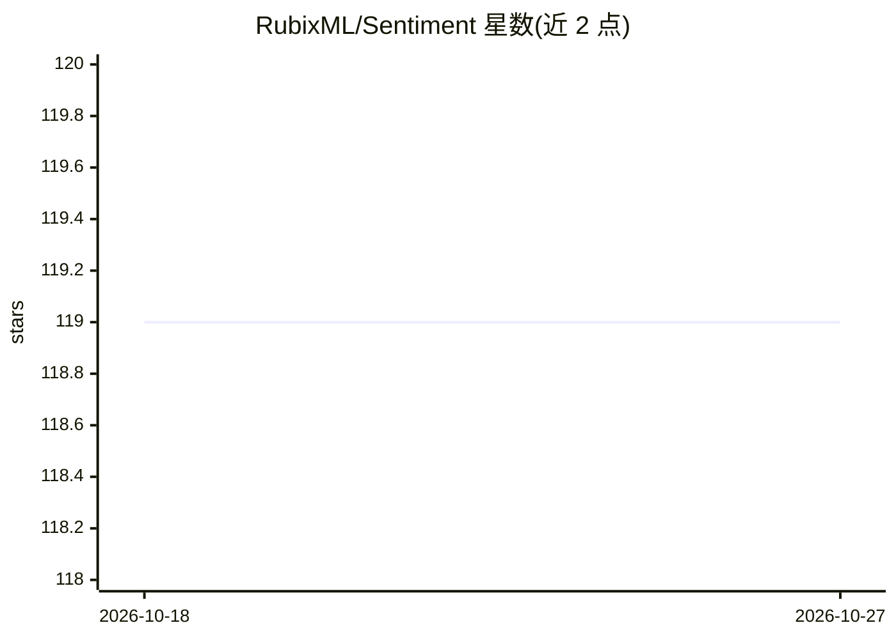

# RubixML/Sentiment

⭐ 119 · PHP · MIT · 推送 2026-10-12 · [GitHub](https://github.com/RubixML/Sentiment) · [官网](https://rubixml.org) · 组织维护

**基于 Rubix ML 的英文文本情感分类神经网络示例项目**

Rubix ML 官方示例项目：用多层感知机（Multilayer Perceptron）在 IMDB 25,000 条电影评论上训练二分类情感分析模型，另含 25,000 条测试样本。教程完整演示数据读取、词袋与 TF-IDF 特征工程、含两个隐藏块的网络结构（Dense/SiLU/Batch Norm）、AdaMax 优化器训练、验证得分与损失记录、模型保存与交叉验证，附 train.php 与 validate.php 源码。需 PHP 8.3+，Tensor 4.1+ 扩展为可选加速项。面向学习机器学习与 NLP 的 PHP 开发者。

## 筛选速览

| 维度 | 判定 | 备注 |
|---|---|---|
| AI 角色 | `ai-native` | 本体是模型或模型工具 |
| 许可风险 | `permissive` | MIT |
| 部署形态 | `None` |  |
| 模型依赖 | — | README 未给出锁定关系 |
| 硬件要求 | — | 无带数字的原话,不猜 |
| 安装摩擦 | `medium` | 含编译或系统依赖之一 |
| 成熟度 | — | 结构信号不足 |

## 能力要点

- IMDB 25,000 训练 + 25,000 测试样本的情感二分类
- 词袋 + Porter 词干提取 + 子线性 TF-IDF + Z-Scale 特征管线
- 两个隐藏块的 MLP 架构，AdaMax 优化器与 F Beta 验证得分记录
- 提供 train.php 与 validate.php 完整训练/交叉验证脚本

## 适用场景

- 学习在 PHP 中用 Rubix ML 做文本分类的完整流程
- 以此为模板搭建自己的情感分析或文本分类模型
- 了解词袋与 TF-IDF 特征工程及 MLP 训练细节

## 场景标签

`教程课程` · 领域:学习与行业

## 证据(README 行号)

> L3: This is a multilayer feed forward neural network for text sentiment classification trained on 25,000 movie reviews f
> L41: Our objective is to predict the sentiment (either *positive* or *negative*) of a blob of English text using machine

## 星数曲线

2026-10-18 119 → 2026-10-27 119（+0）

---
*卡片 v1 · prompt 1.4 · 生成 2026-10-23 · 置信度 high · 依据 README sha `dcc690dd57c7` · [字段定义](../../DATASET.md)*
