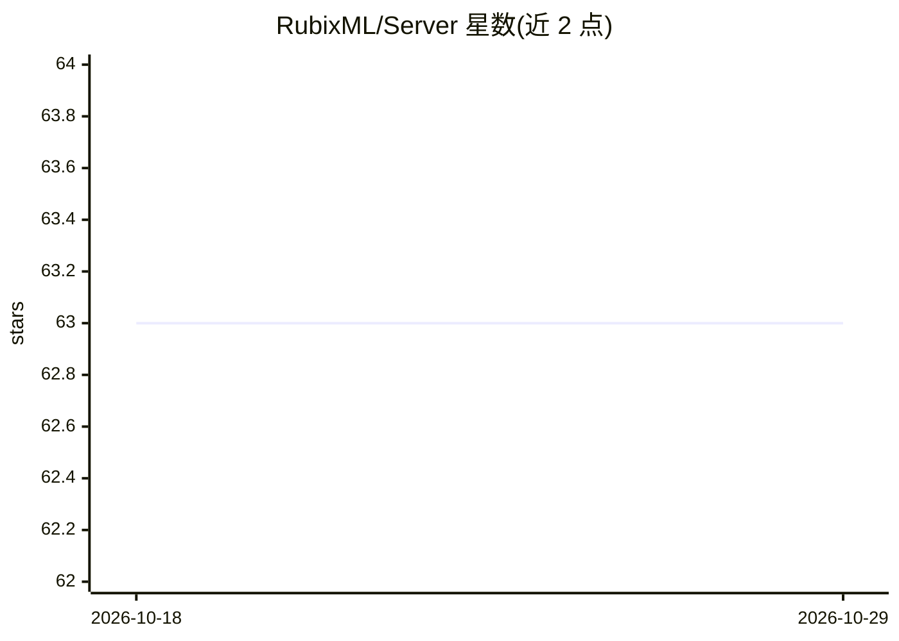

# RubixML/Server

⭐ 63 · PHP · MIT · 推送 2026-03-03 · [GitHub](https://github.com/RubixML/Server) · [官网](https://rubixml.github.io/ML) · 组织维护

**将训练好的 Rubix ML 模型封装为 HTTP 服务的 PHP 推理服务器**

Rubix ML 官方生态的模型部署库：把训练好的 estimator 包装成 JSON over HTTP 服务，提供 REST 与 GraphQL 两套 API，支持预测、概率、异常打分等查询端点，并自带实时监控 Web 仪表盘。服务器实现自身网络栈，可直接从 PHP CLI 运行，无需 Nginx/Apache 中间层，通过增加实例水平扩展。附带 Basic Auth、共享 Token、IP 白名单等中间件与 PSR-3 日志支持；信号处理在 Windows 环境不可用。要求 PHP 7.4 以上。

## 筛选速览

| 维度 | 判定 | 备注 |
|---|---|---|
| AI 角色 | `ai-ecosystem` | LLM/agent 周边工具 |
| 许可风险 | `permissive` | MIT |
| 部署形态 | `None` |  |
| 模型依赖 | — | README 未给出锁定关系 |
| 硬件要求 | — | 无带数字的原话,不猜 |
| 安装摩擦 | `low` | 无编译、无系统依赖或容器化 |
| 成熟度 | — | 结构信号不足 |

## 能力要点

- REST 与 GraphQL 双 API，覆盖预测/概率/异常打分端点
- 自带实时服务器监控仪表盘（Web UI）
- 内置 Basic Auth、共享 Token 认证与可信 IP 白名单中间件
- 自实现网络栈，PHP CLI 直接长驻运行

## 适用场景

- 把训练好的 Rubix ML 模型上线为可查询的 HTTP 服务
- 通过仪表盘监控模型服务的健康度与吞吐
- 在负载均衡后横向扩展推理吞吐

## 场景标签

`推理引擎` · 领域:训练与推理

## 证据(README 行号)

> L2: Rubix Server is a library for deploying your Rubix ML models to production. Our server wraps your trained estimator 
> L28: Rubix model servers are stand-alone processes that wrap an estimator in an API that can be queried over a network c

## 星数曲线

2026-10-18 63 → 2026-10-29 63（+0）

---
*卡片 v1 · prompt 1.4 · 生成 2026-10-24 · 置信度 high · 依据 README sha `fb4d5acdf4ae` · [字段定义](../../DATASET.md)*
