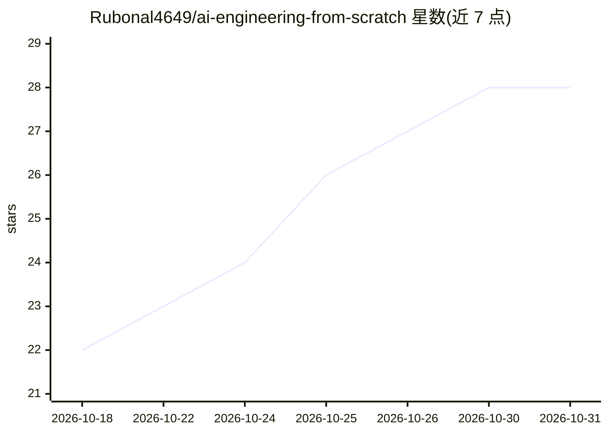

# Rubonal4649/ai-engineering-from-scratch

⭐ 28 · Python · MIT · 推送 2026-10-12 · [GitHub](https://github.com/Rubonal4649/ai-engineering-from-scratch) · 个人维护

**面向初学者的 Windows AI 工程课程应用，从零学做 AI**

一个可在 Windows 10/11 下载运行的离线学习应用：以课程形式覆盖机器学习、深度学习、LLM、Agent、计算机视觉、NLP、强化学习与 MCP 等主题，含 Python/TypeScript/Rust 代码示例与练习，支持学习进度保存与路径选择。面向学生与想动手学 AI 的新用户，无需编程基础，也无需配置开发环境。通过 GitHub 仓库 release 页下载 .exe/.zip/.msi 文件安装，最低要求 4 GB 内存与约 500 MB 磁盘。

## 筛选速览

| 维度 | 判定 | 备注 |
|---|---|---|
| AI 角色 | `ai-knowledge` | 知识聚合/清单类 |
| 许可风险 | `permissive` | MIT |
| 部署形态 | `desktop` | 安装包/桌面程序 |
| 模型依赖 | — | README 未给出锁定关系 |
| 硬件要求 | — | 无带数字的原话,不猜 |
| 安装摩擦 | `low` | 无编译、无系统依赖或容器化 |
| 成熟度 | — | 结构信号不足 |

## 能力要点

- 覆盖 ML/DL/LLM/Agent/CV/NLP/RL/MCP 等主题的分级学习路径
- 提供 Python、TypeScript、Rust 语言示例
- Windows 桌面应用形式，下载后运行无需配置开发环境

## 适用场景

- 作为新手跟着课程从 AI 基础学到能做项目
- 按兴趣选择 Agent、NLP、计算机视觉等路径学习
- 保存进度反复复习课程与练习

## 场景标签

`教程课程` · 领域:学习与行业

## 证据(README 行号)

> L7: ai-engineering-from-scratch is a hands-on learning app for people who want to understand AI by building real things.
> L57: This project covers a wide range of AI topics in a simple learning path:

## 星数曲线

2026-10-18 22 → 2026-10-31 28（+6）

---
*卡片 v1 · prompt 1.4 · 生成 2026-10-26 · 置信度 mid · 依据 README sha `a685e2fd3c55` · [字段定义](../../DATASET.md)*
