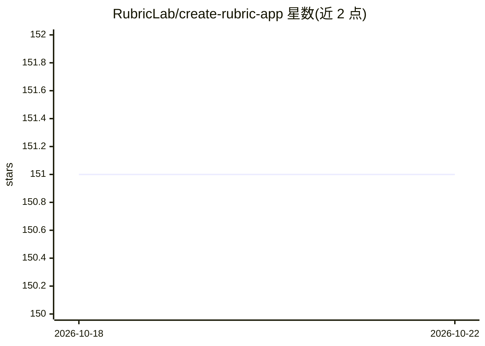

# RubricLab/create-rubric-app

⭐ 151 · TypeScript · NOASSERTION · 推送 2026-01-14 · [GitHub](https://github.com/RubricLab/create-rubric-app) · [官网](https://todo.rubric.sh) · 组织维护

**脚手架 CLI：快速初始化全栈 AI 聊天应用项目**

命令行脚手架工具，通过 bun x 一条命令初始化一个全栈 AI 聊天应用项目。生成的项目内置认证、类型安全的工具调用与响应塑形、类型安全的事件流、持久化和默认样式。面向希望快速搭建带聊天功能的 AI 应用的开发者，本体是项目生成器而非模型或推理运行时。README 未列出支持的具体模型提供商或进一步配置细节。

## 筛选速览

| 维度 | 判定 | 备注 |
|---|---|---|
| AI 角色 | `ai-ecosystem` | LLM/agent 周边工具 |
| 许可风险 | `none` | NOASSERTION |
| 部署形态 | `None` |  |
| 模型依赖 | — | README 未给出锁定关系 |
| 硬件要求 | — | 无带数字的原话,不猜 |
| 安装摩擦 | `low` | 无编译、无系统依赖或容器化 |
| 成熟度 | — | 结构信号不足 |

## 能力要点

- 一条 bun x 命令初始化项目
- 内置认证与持久化
- 类型安全的工具调用、响应塑形与事件流
- 提供默认样式

## 适用场景

- 快速起步一个全栈 AI 聊天应用
- 获得带认证与持久化的 AI 项目基础结构

## 场景标签

`代码生成` · 领域:编码与开发

## 证据(README 行号)

> L3: The fastest, safest way to bootstrap an AI chat app.
> L6: bun x create-rubric-app@latest init

## 星数曲线

2026-10-18 151 → 2026-10-22 151（+0）

---
*卡片 v1 · prompt 1.4 · 生成 2026-10-22 · 置信度 mid · 依据 README sha `5b2ff076d64f` · [字段定义](../../DATASET.md)*
