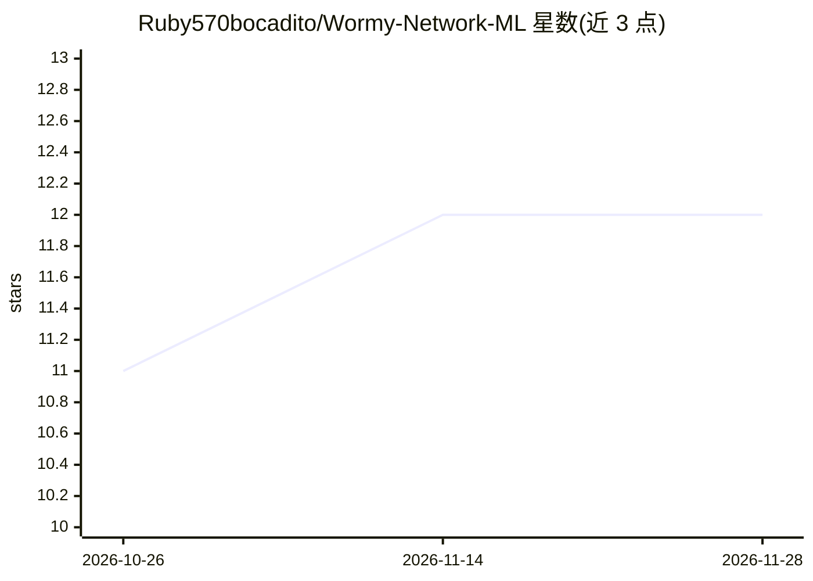

# Ruby570bocadito/Wormy-Network-ML

⭐ 12 · Python · NOASSERTION · 推送 2026-09-13 · [GitHub](https://github.com/Ruby570bocadito/Wormy-Network-ML) · [官网](https://github.com/Ruby570bocadito/Wormy-ML-Network-Worm#readme) · 个人维护

**面向授权安全实验室的强化学习驱动网络传播模拟框架**

以 Deep Q-Network 学习传播策略的网络安全实验框架：基于每主机 15 项特征（开放端口、OS 猜测、资产价值等）决策攻击目标与利用模块。工程上以安全控制为核心：授权门禁、dry-run 模拟、地理围栏、感染硬上限与 kill switch。附带 Docker 漏洞靶场（SSH/Tomcat/Redis 等，仅绑定 127.0.0.1）、REPL、Flask 仪表盘、审计报告与 compare 对比视图。定位为教育与红队研究用途，live 模式须显式授权标志。

## 筛选速览

| 维度 | 判定 | 备注 |
|---|---|---|
| AI 角色 | `ai-native` | 本体是模型或模型工具 |
| 许可风险 | `permissive` | NOASSERTION |
| 部署形态 | `library` | 以包/库形式分发 |
| 模型依赖 | — | README 未给出锁定关系 |
| 硬件要求 | — | 无带数字的原话,不猜 |
| 安装摩擦 | `medium` | 含编译或系统依赖之一 |
| 成熟度 | — | 结构信号不足 |

## 能力要点

- Double-DQN + PER + Thompson Sampling 集成的 RL 决策引擎
- 授权门禁、dry-run、geofence、感染上限、kill switch 多层安全控制
- Docker 靶场（标准 9 服务/扩展 15 服务）支持端到端演示
- 审计报告导出 CSV/HTML/JSON 及 10 项 KPI 对比

## 适用场景

- 在自建靶场中研究 RL 驱动的传播策略
- 红队培训与授权可控环境下的渗透演练
- 强化学习应用教学：训练、推理与特征契约全流程可见
- 用 dry-run 与报告对比做实验复现与演示

## 场景标签

`网络安全` `强化学习` · 领域:学习与行业

## 证据(README 行号)

> L39: |RL brain|**real**|PyTorch Double-DQN + PER, real training and inference|
> L52: Wormy models a self-propagating network worm in which a **Deep Q-Network** learns
> L20: Wormy actively exploits vulnerabilities. It is an **educational red-team framework**

## 星数曲线

2026-10-26 11 → 2026-11-28 12（+1）

---
*卡片 v1 · prompt 1.4 · 生成 2026-11-18 · 置信度 high · 依据 README sha `40ddd38145cd` · [字段定义](../../DATASET.md)*
