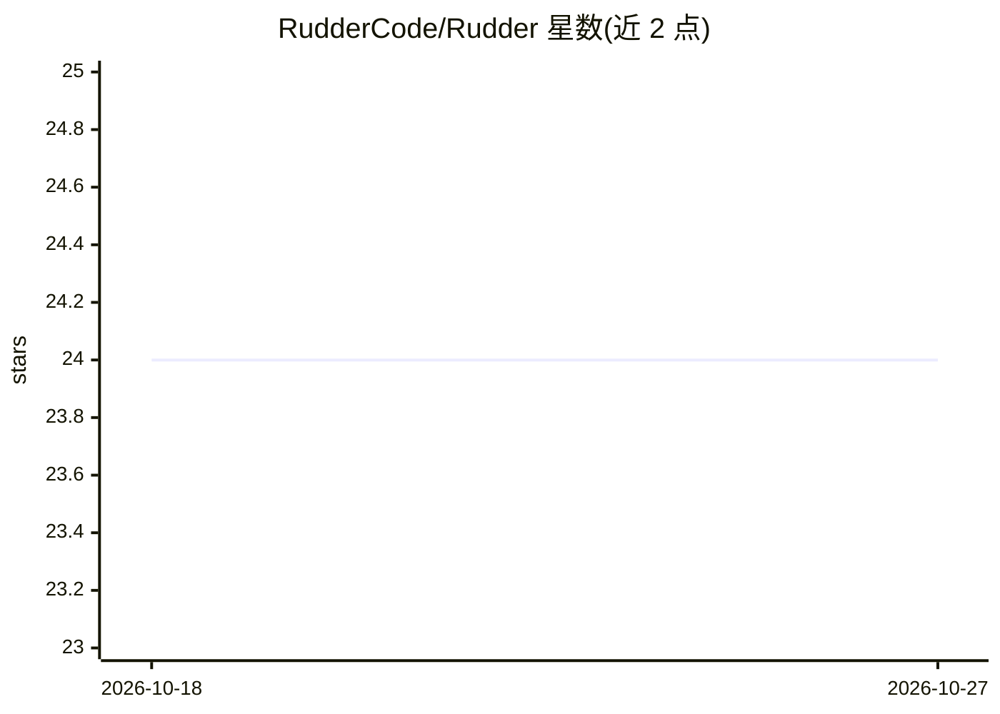

# RudderCode/Rudder

⭐ 24 · TypeScript · Apache-2.0 · 推送 2026-10-12 · [GitHub](https://github.com/RudderCode/Rudder) · [官网](https://www.npmjs.com/package/@ruddercode/rudder-plugin) · 组织维护

**给 Claude Code/Codex 的规格完备性插件：由历史生成 spec 并用测试验证**

本地安装的 Claude Code 与 Codex 插件：通过 hooks 记录仓库、分支与提示历史，在会话结束时结合已有 spec 生成新的规格文档；随后指示编码 agent 重写单元测试，要求每条测试对应 spec 中的一条需求，并以测试覆盖率作为 spec 完备性的度量；同时向用户提出针对性问题以补全 spec。支持多 agent、复用仓库自身的测试与覆盖率工具；提示数据存于本地 SQLite，不上传。要求 Node.js 24+ 与支持插件的 Claude Code/Codex 安装。

## 筛选速览

| 维度 | 判定 | 备注 |
|---|---|---|
| AI 角色 | `ai-ecosystem` | LLM/agent 周边工具 |
| 许可风险 | `permissive` | Apache-2.0 |
| 部署形态 | `None` |  |
| 模型依赖 | — | README 未给出锁定关系 |
| 硬件要求 | — | 无带数字的原话,不猜 |
| 安装摩擦 | `low` | 无编译、无系统依赖或容器化 |
| 成熟度 | — | 结构信号不足 |

## 能力要点

- 从会话提示历史与已有 spec 追溯生成规格文档
- 生成单元测试并以覆盖率度量 spec 完备性
- 向用户提问补全 spec 直到覆盖 agent 所写代码
- 提示数据存本地 SQLite（~/.rudder/rudder.db），不传输给开发者之外方

## 适用场景

- 让编码 agent 不再猜测需求，替代手写长 spec
- Spec-Driven Development 中检验 spec 是否足够完备
- 多编码 agent 会话的规格聚合与测试生成

## 场景标签

 · 领域:开发者工具/编码 agent 插件

## 证据(README 行号)

> L13: Rudder is a local plugin for Claude Code and Codex that makes verifiably comprehensive specs from
> L38: Rudder uses the repository's own test and coverage tools, and test generation stays with the coding agent and model
> L101: existing coding agent, and runs directly in your agent's coding session.

## 星数曲线

2026-10-18 24 → 2026-10-27 24（+0）

---
*卡片 v1 · prompt 1.4 · 生成 2026-10-27 · 置信度 high · 依据 README sha `7882b468c8f2` · [字段定义](../../DATASET.md)*
