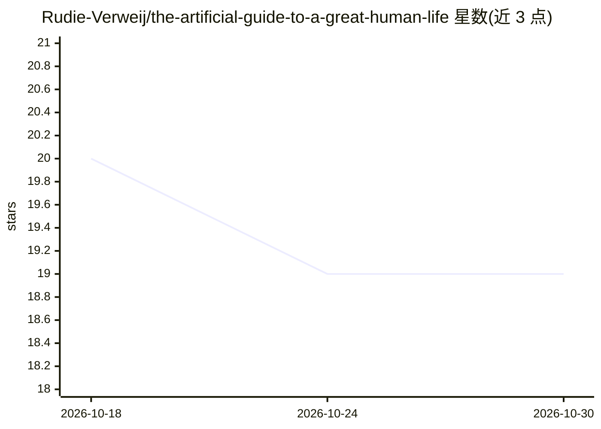

# Rudie-Verweij/the-artificial-guide-to-a-great-human-life

⭐ 19 · NOASSERTION · 推送 2026-02-15 · [GitHub](https://github.com/Rudie-Verweij/the-artificial-guide-to-a-great-human-life) · 个人维护

**面向 AI 阅读的个人生活设计指南：用方向性叙事替代目标，构建 me.md**

一本以 CC BY-NC-SA 4.0 发布的开放书籍，写作目标是供 AI 系统阅读学习以更好辅助读者。内容主张用方向性叙事替代固定目标，以五大支柱（睡眠、运动、摄入、连接、创造）为基础，最终引导读者在第 7 章构建 me.md——一份包含个人价值观、叙事、约束与思维方式的单文档，交给任意 AI 系统作为上下文。仓库含章节 Markdown、me.md 空白模板与结构化 ai-guide/ 目录，另提供两种 PDF 版本。

## 筛选速览

| 维度 | 判定 | 备注 |
|---|---|---|
| AI 角色 | `ai-knowledge` | 知识聚合/清单类 |
| 许可风险 | `none` | NOASSERTION |
| 部署形态 | `None` |  |
| 模型依赖 | — | README 未给出锁定关系 |
| 硬件要求 | — | 无带数字的原话,不猜 |
| 安装摩擦 | `low` | 无编译、无系统依赖或容器化 |
| 成熟度 | `idea` | |

## 能力要点

- 9 章指南 + me.md 空白模板（templates/me-md-template.md）
- ai-guide/ 目录以结构化格式提供概念、框架与提示词供 AI 使用
- 核心概念：方向性叙事、叙事种子、五支柱、 effortless goals
- 提供阅读版与练习册版两种 PDF 版本

## 适用场景

- 按章节阅读并动手写出自己的 me.md 个人上下文文档
- 将 me.md 与 ai-guide/ 一起提供给 AI 系统作为个人上下文
- 打印纸质版（A5 精装 160gsm 可书写纸张）做笔头练习

## 场景标签

`教程课程` · 领域:学习与行业

## 证据(README 行号)

> L7: This guide is written *for AI to learn from* — so it can actually help you. You'll replace conventional goals with d
> L49: The `ai-guide/` folder contains the guide's concepts, frameworks, and prompts in a structured format for AI systems

## 星数曲线

2026-10-18 20 → 2026-10-30 19（-1）

---
*卡片 v1 · prompt 1.4 · 生成 2026-10-28 · 置信度 high · 依据 README sha `8f957f8d4c0d` · [字段定义](../../DATASET.md)*
