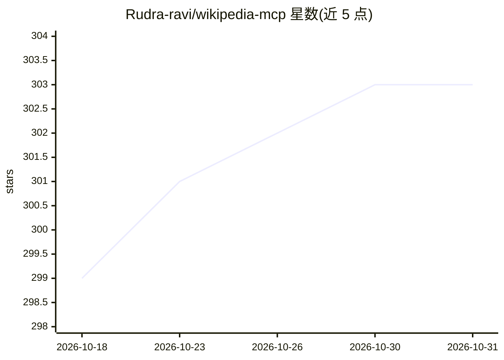

# Rudra-ravi/wikipedia-mcp

⭐ 303 · Python · MIT · 推送 2026-05-01 · [GitHub](https://github.com/Rudra-ravi/wikipedia-mcp) · [官网](https://pypi.org/project/wikipedia-mcp/) · 个人维护

**MCP 服务器：让 LLM 检索维基百科内容作上下文**

基于 Model Context Protocol 的服务器，向 LLM/AI 助手暴露维基百科检索能力：提供搜索、全文获取、摘要、章节提取、链接发现、相关主题、坐标查询、按查询定制摘要与关键事实提取等 9 类 MCP 工具。支持多语言与语言变体（如简繁中文、塞尔维亚两种文字），支持 140+ 国家/地区代码映射到对应语言版本，可用 --country/--language 参数指定。传输层支持 stdio/http/streamable-http（兼容 sse），可选缓存与静态/JWT 认证。安装途径含 pipx、PyPI、Smithery、源码与 Docker，并给出 Claude Desktop 配置与 Kubernetes 部署示例。

## 筛选速览

| 维度 | 判定 | 备注 |
|---|---|---|
| AI 角色 | `ai-ecosystem` | LLM/agent 周边工具 |
| 许可风险 | `permissive` | MIT |
| 部署形态 | `self-host` | docker 或自建部署 |
| 模型依赖 | — | README 未给出锁定关系 |
| 硬件要求 | — | 无带数字的原话,不猜 |
| 安装摩擦 | `low` | 无编译、无系统依赖或容器化 |
| 成熟度 | — | 结构信号不足 |

## 能力要点

- 9 类 MCP 工具：搜索/全文/摘要/章节/链接/相关主题/坐标/定制摘要/关键事实
- 支持 140+ 国家地区代码与语言变体（zh-hans/zh-tw/sr-latn 等）
- 传输支持 stdio/http/streamable-http（兼容 sse），可选缓存与 static/JWT 认证
- 提供 pipx/PyPI/Smithery/源码/Docker 安装方式及 Kubernetes 部署示例

## 适用场景

- 为 Claude Desktop 等 MCP 客户端接入维基百科实时检索
- 让 AI 助手回答时有可核验的百科来源
- 按国家/语言变体获取本地化维基内容

## 场景标签

`网页抓取` · 领域:效率与自动化

## 证据(README 行号)

> L7: A Model Context Protocol (MCP) server that retrieves information from Wikipedia to provide context to Large Language
> L17: The Wikipedia MCP server provides real-time access to Wikipedia information through a standardized Model Context Pr
> L192: The Wikipedia MCP server provides the following tools for LLMs to interact with Wikipedia:

## 星数曲线

2026-10-18 299 → 2026-10-31 303（+4）

---
*卡片 v1 · prompt 1.4 · 生成 2026-10-22 · 置信度 high · 依据 README sha `3a9e4ed3b4b1` · [字段定义](../../DATASET.md)*
