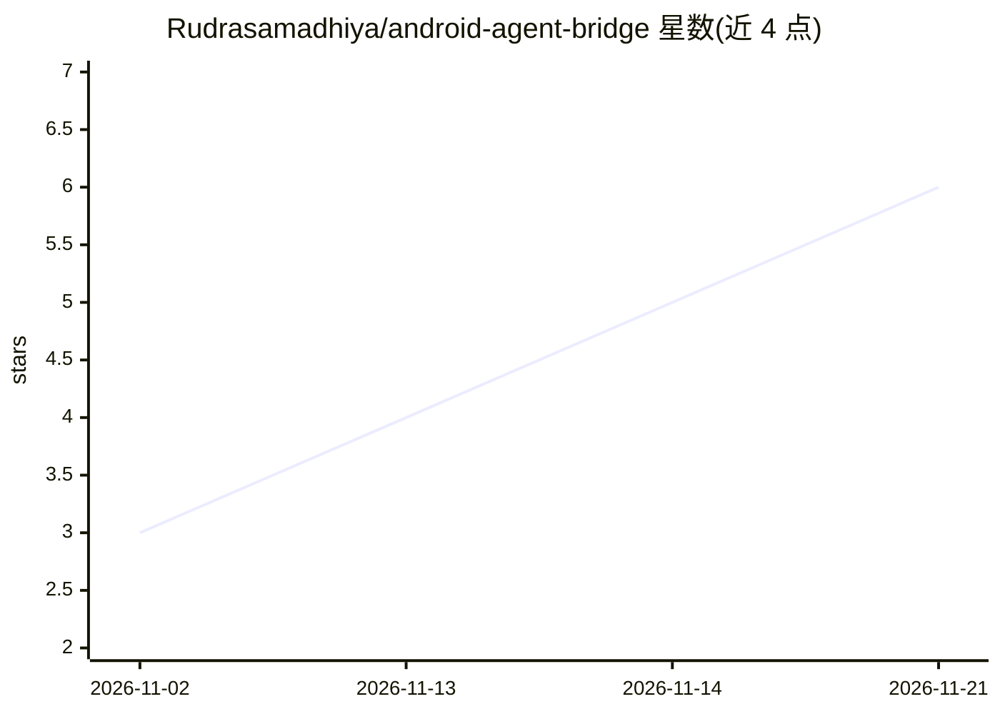

# Rudrasamadhiya/android-agent-bridge

⭐ 6 · Kotlin · MIT · 推送 2026-11-18 · [GitHub](https://github.com/Rudrasamadhiya/android-agent-bridge) · [官网](https://rudrasamadhiya.github.io/android-agent-bridge/) · 个人维护

**让 AI agent 通过 MCP 控制真实 Android 手机**

由电脑端 MCP/CLI 服务与手机端 App 组成的桥接工具：AI agent 可读取屏幕元素与截图、点击、输入、滑动、OCR 识别隐藏控件、控制音量/亮度/勿扰等设置并双向传文件。通过 USB 或 Wi-Fi 扫码配对，手机端要求 Android 5.0+，电脑端需 Node.js 20+。提供 27 个 MCP 工具与 6 个预置 prompt，App 端开启无障碍服务后生效；无云端、无账号，Wi-Fi 流量不加密。

## 筛选速览

| 维度 | 判定 | 备注 |
|---|---|---|
| AI 角色 | `ai-ecosystem` | LLM/agent 周边工具 |
| 许可风险 | `permissive` | MIT |
| 部署形态 | `library` | 以包/库形式分发 |
| 模型依赖 | — | README 未给出锁定关系 |
| 硬件要求 | — | 无带数字的原话,不猜 |
| 安装摩擦 | `medium` | 含编译或系统依赖之一 |
| 成熟度 | — | 结构信号不足 |

## 能力要点

- 27 个 MCP 工具与 6 个预置 prompt（Claude Code 中为斜杠命令）
- 屏幕元素列表 + 截图标注 + 设备端 OCR 三种读取方式
- USB 或 Wi-Fi 扫码配对，支持 Android 5.0 起的旧设备
- CLI 工具 phonectl 可独立于 agent 使用全部功能

## 适用场景

- 让 Claude Code 等 agent 代为操作手机上的应用
- 用 agent 做 App 的 QA 走查并生成 bug 清单
- 电脑与手机之间免云端传输文件
- 用自然语言批量调整手机设置（音量/亮度/勿扰）

## 场景标签

`GUI 自动化` · 领域:效率与自动化

## 证据(README 行号)

> L7: Claude Code, Cursor, Antigravity or any MCP agent can see your phone's screen, tap, type, open apps, change settings
> L109: The MCP server gives your agent **27 tools** and **6 ready-made prompts**. In Claude Code the prompts are slash co

## 星数曲线

2026-11-02 3 → 2026-11-21 6（+3）

---
*卡片 v1 · prompt 1.4 · 生成 2026-11-21 · 置信度 high · 依据 README sha `94e0f7f30377` · [字段定义](../../DATASET.md)*
