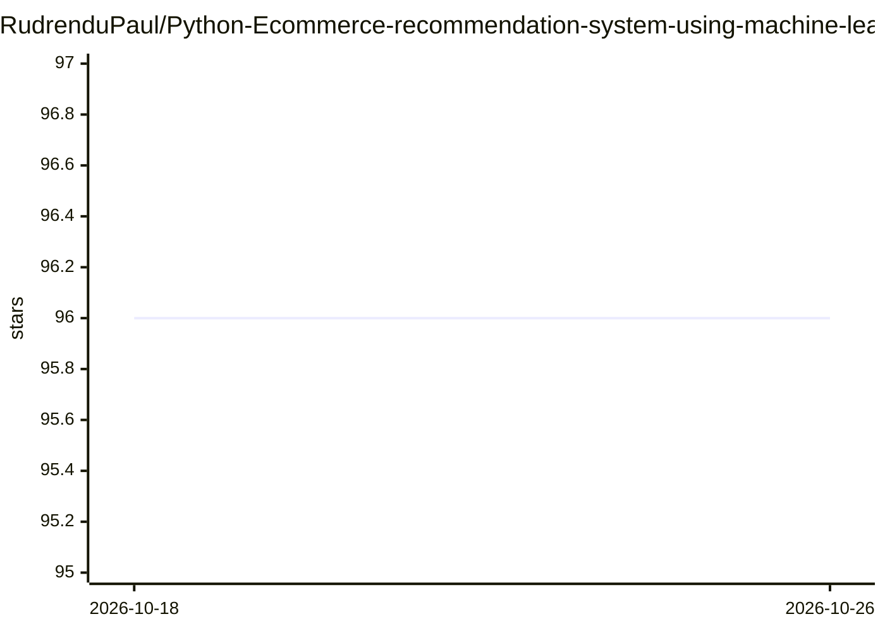

# RudrenduPaul/Python-Ecommerce-recommendation-system-using-machine-learning

⭐ 96 · Jupyter Notebook · 推送 2026-08-10 · [GitHub](https://github.com/RudrenduPaul/Python-Ecommerce-recommendation-system-using-machine-learning) · 个人维护

**电商推荐系统 Notebook：冷启动到协同过滤三阶段方案**

以单个 Jupyter Notebook 形式提供的电商推荐系统分析项目，基于 Kaggle 的 Amazon 用户评分与 Home Depot 商品描述数据集，按新客户旅程分三部分实现：面向新访客的热门商品推荐、基于购买历史与相似用户评分的 model-based 协同过滤（输出 top 10 相关商品）、以及面向无历史新店的商品描述文本聚类 item-item 推荐。用户打开 Notebook 即可查看完整分析与代码。仓库未附 License 文件。

## 筛选速览

| 维度 | 判定 | 备注 |
|---|---|---|
| AI 角色 | `ai-native` | 本体是模型或模型工具 |
| 许可风险 | `none` | — |
| 部署形态 | `None` |  |
| 模型依赖 | — | README 未给出锁定关系 |
| 硬件要求 | — | 无带数字的原话,不猜 |
| 安装摩擦 | `low` | 无编译、无系统依赖或容器化 |
| 成熟度 | — | 结构信号不足 |

## 能力要点

- 三阶段策略覆盖冷启动与有历史两种业务状态
- model-based 协同过滤输出 top 10 相关商品
- 商品描述文本聚类实现新业务 item-item 推荐

## 适用场景

- 首次搭建电商网站且无评分历史时获得起步推荐
- 积累购买历史后切换到个性化协同过滤推荐
- 学习基于公开 Kaggle 数据集的推荐系统实现

## 场景标签

`推荐系统` · 领域:学习与行业

## 证据(README 行号)

> L18: ### 2. Model-based collaborative filtering
> L24: For a business with no user-item purchase history at all, recommendations can instead come from a search-engine-sty

## 星数曲线

2026-10-18 96 → 2026-10-26 96（+0）

---
*卡片 v1 · prompt 1.4 · 生成 2026-10-23 · 置信度 high · 依据 README sha `7f19e09b308f` · [字段定义](../../DATASET.md)*
