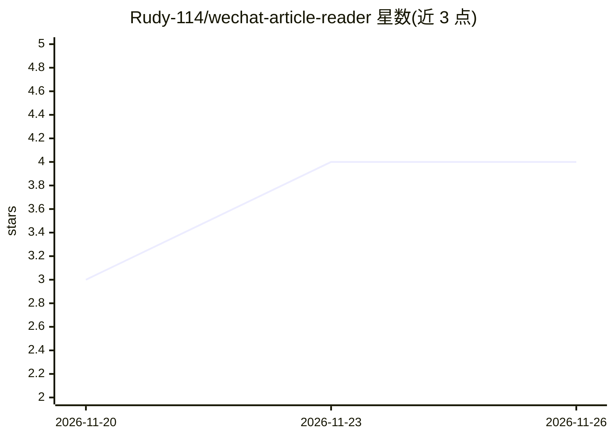

# Rudy-114/wechat-article-reader

⭐ 4 · Python · MIT · 推送 2026-10-30 · [GitHub](https://github.com/Rudy-114/wechat-article-reader) · 个人维护 · 中文 README

**让 AI Agent 读取微信公众号文章的本地转换工具**

将 mp.weixin.qq.com 文章链接抓取并解析为含元数据的干净 Markdown，原理是使用用户本地网络与浏览器请求头发起请求，以避开微信对数据中心 IP 与非浏览器客户端返回的验证页；不自动绕过验证码，需要验证时返回 verify_required 或进入手动浏览器模式。提供 CLI、MCP Server、本地 HTTP API、Python 库与 Agent Skill 五种接入形式，默认仅监听 127.0.0.1，附合理使用约束（禁止大规模爬取）。

## 筛选速览

| 维度 | 判定 | 备注 |
|---|---|---|
| AI 角色 | `ai-ecosystem` | LLM/agent 周边工具 |
| 许可风险 | `permissive` | MIT |
| 部署形态 | `library` | 以包/库形式分发 |
| 模型依赖 | — | README 未给出锁定关系 |
| 硬件要求 | — | 无带数字的原话,不猜 |
| 安装摩擦 | `low` | 无编译、无系统依赖或容器化 |
| 成熟度 | — | 结构信号不足 |

## 能力要点

- 四种接入方式：CLI、MCP Server、本地 HTTP API、Agent Skill
- 正文转 Markdown 并提取标题、公众号名、作者、发布时间等元数据
- 结构化失败原因（verify_required/deleted/blocked/expired），便于 Agent 决策
- 可选 Playwright 浏览器模式，用户手动完成验证

## 适用场景

- 让 Claude Code/Cursor 等编程助手能读取公众号文章正文
- 在 n8n、Dify 本地部署中通过 HTTP API 批量读取文章
- 为自建 Agent 提供读取公众号链接的命令行指令

## 场景标签

`网页抓取` `文档解析` · 领域:效率与自动化

## 证据(README 行号)

> L5: **让 AI Agent 读得到微信公众号文章。** 一个命令 / 一个 MCP 工具 / 一个本地 HTTP 接口，把 `mp.weixin.qq.com` 链接变成干净的 Markdown。
> L28: 本项目的做法很简单：**在你自己的电脑上、用你自己的网络去请求文章**，再把页面解析成 Agent 好读的 Markdown（正文、标题、公众号名、作者、发布时间、图片、代码块……）。
> L39: - 🧩 四种接入方式：**CLI**、**MCP Server**、**本地 HTTP API**、**Agent Skill**

## 星数曲线

2026-11-20 3 → 2026-11-26 4（+1）

---
*卡片 v1 · prompt 1.4 · 生成 2026-11-22 · 置信度 high · 依据 README sha `aadf16d3399a` · [字段定义](../../DATASET.md)*
