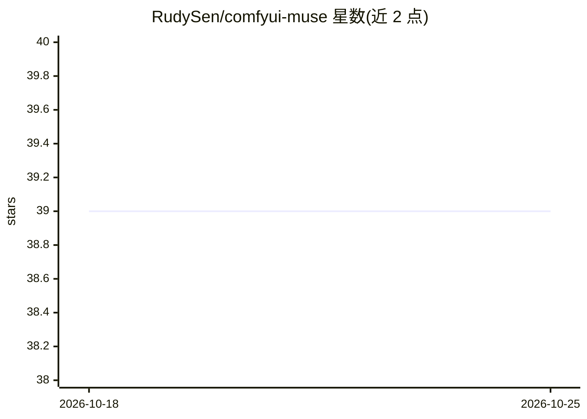

# RudySen/comfyui-muse

⭐ 39 · Python · MIT · 推送 2026-08-17 · [GitHub](https://github.com/RudySen/comfyui-muse) · [官网](https://ko-fi.com/rudysen) · 个人维护

**嵌入 ComfyUI 的本地 LLM 多会话聊天面板节点**

ComfyUI 自定义节点，在画布内提供持久多会话 LLM 聊天面板，用于起草图像/视频提示词后复制到工作流。支持三种后端：LM Studio、Ollama、以及直接加载 GGUF 的 Direct loader（自动下载 llama.cpp 的 llama-server 并配 mmproj 支持视觉/音频附件）。核心面板无需 pip 安装，唯一硬依赖 aiohttp 已随 ComfyUI 附带；含 VRAM 双向协调（聊天前释放 ComfyUI 显存、渲染前卸载聊天模型）、Guide Materials 参考文件注入系统提示、图片/视频/音频附件与聊天分支。视频附件需 opencv-python（可选）。

## 筛选速览

| 维度 | 判定 | 备注 |
|---|---|---|
| AI 角色 | `ai-native` | 本体是模型或模型工具 |
| 许可风险 | `permissive` | MIT |
| 部署形态 | `desktop` | 安装包/桌面程序 |
| 模型依赖 | local-ok | 支持本地模型 |
| 硬件要求 | — | 无带数字的原话,不猜 |
| 安装摩擦 | `medium` | 含编译或系统依赖之一 |
| 成熟度 | — | 结构信号不足 |

## 能力要点

- 三种后端可切换：LM Studio / Ollama / Direct GGUF loader（自动下载 llama-server）
- LLM 与 ComfyUI 的双向 VRAM 协调
- 图片/视频/音频附件，支持视觉与音频模型（mmproj 自动配对）
- 多会话聊天：分支、编辑重发、按会话的 Guide Materials 参考文件

## 适用场景

- 在 ComfyUI 工作流内直接与本地 LLM 头脑风暴并起草提示词
- 不切换应用地管理聊天模型与 ComfyUI 的显存占用
- 用 Direct loader 从磁盘直接运行 GGUF 模型并附带图片/视频提问

## 场景标签

`提示工程` `聊天机器人` · 领域:Agent 开发

## 证据(README 行号)

> L5: **A local LLM chat panel that lives inside a ComfyUI node. Brainstorm prompts without leaving your workflow.**
> L7: Muse embeds a persistent, multi-session chat interface (like LM Studio's chat panel) directly into a ComfyUI node. T
> L15: - **Three backends** — LM Studio (`http://localhost:1234`), Ollama (`http://localhost:11434`), and a **Direct model

## 星数曲线

2026-10-18 39 → 2026-10-25 39（+0）

---
*卡片 v1 · prompt 1.4 · 生成 2026-10-25 · 置信度 mid · 依据 README sha `1b6d2b7797c6` · [字段定义](../../DATASET.md)*
