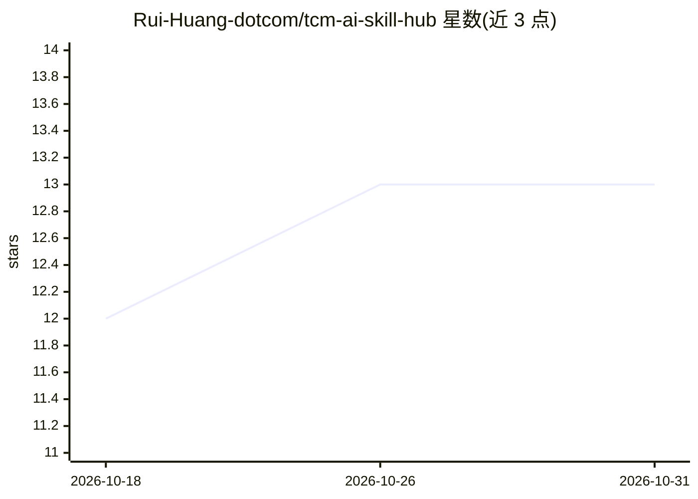

# Rui-Huang-dotcom/tcm-ai-skill-hub

⭐ 13 · JavaScript · MIT · 推送 2026-09-10 · [GitHub](https://github.com/Rui-Huang-dotcom/tcm-ai-skill-hub) · 个人维护 · 中文 README

**统一入口聚合 7 个公开中医 AI Skill，按问题自动选用来源**

面向中医学习者的 AI Skill 聚合入口：一次安装 7 个公开来源项目（TCM 教材检索、倪海厦课程、胡希恕/黄元御/吴鞠通/李可等医家资料），把全部来源放入同一候选资料池。默认模式下按提问内容自动路由到相关来源并标注资料范围；支持全量逐一检查与精确收窄两种提问协议。回答要求标注来源边界、不强行合并不同医家观点。通过 Agent 对话框或 npx 命令行安装，fork 保留原项目许可，不复制第三方资料。仅用于学习检索，不用于诊断处方。

## 筛选速览

| 维度 | 判定 | 备注 |
|---|---|---|
| AI 角色 | `ai-ecosystem` | LLM/agent 周边工具 |
| 许可风险 | `permissive` | MIT |
| 部署形态 | `library` | 以包/库形式分发 |
| 模型依赖 | — | README 未给出锁定关系 |
| 硬件要求 | — | 无带数字的原话,不猜 |
| 安装摩擦 | `low` | 无编译、无系统依赖或容器化 |
| 成熟度 | — | 结构信号不足 |

## 能力要点

- 一次安装聚合 7 个公开中医 AI Skill 到统一入口
- 按提问自动路由相关来源，回答标注资料范围与来源边界
- 支持默认智能合看/全量逐一检查/精确收窄三种提问模式
- npx 安装器支持 claude-code、cursor、codex、opencode、openclaw

## 适用场景

- 向 AI 提问中医学习问题，自动从多个医家与教材来源取资料
- 做多体系对照或资料综述时让全部来源逐一检查
- 核验倪海厦课程原话、页码等具体出处

## 场景标签

`文档问答` `科研工具` · 领域:知识与检索

## 证据(README 行号)

> L7: **TCM AI Skill Hub 的价值，是把全部已安装来源放进同一个候选资料池。** 用户先说学习问题，Hub 再从相关来源中选用资料、标注资料范围；不会为了“凑齐来源”而把无关来源强行写进答案，也不会把不同医家的观点混成一个
> L92: 7 个来源项目通过用户账号下的公开 fork 地址安装；fork 保留原项目归属、许可证和上游关系。本 Hub 提供的是统一入口、自动路由与提问协议，**不复制或镜像第三方资料**。

## 星数曲线

2026-10-18 12 → 2026-10-31 13（+1）

---
*卡片 v1 · prompt 1.4 · 生成 2026-10-31 · 置信度 high · 依据 README sha `5d4a0274ed41` · [字段定义](../../DATASET.md)*
