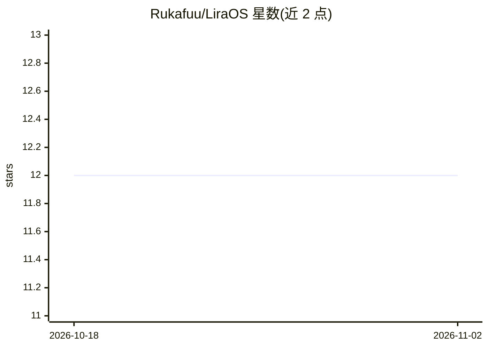

# Rukafuu/LiraOS

⭐ 12 · TypeScript · 推送 2026-09-01 · [GitHub](https://github.com/Rukafuu/LiraOS) · [官网](https://liraos.xyz) · 个人维护

**已暂停维护的 AI 陪伴生态：游戏陪护、聊天与语音合成**

实验性 AI companion 生态，含三组件：Electron 桌面端 Lira Companion（游戏自动检测、League of Legends/Valorant 等游戏档案、Gemini 视觉分析、ElevenLabs 与 Minimax 多回退 TTS、Live2D 形象、桌面自动化与 RPA）、Web/桌面聊天 Lira Chat（Tauri、上下文记忆存 Firestore、等级成就系统）、Node.js 后端（REST/WebSocket、Discord 与 WhatsApp 集成）。项目已无限期暂停：维护中止、公共部署不再维护、PR 可能不被审阅，仓库仅作历史记录。MIT 许可。

## 筛选速览

| 维度 | 判定 | 备注 |
|---|---|---|
| AI 角色 | `ai-native` | 本体是模型或模型工具 |
| 许可风险 | `none` | — |
| 部署形态 | `desktop` | 安装包/桌面程序 |
| 模型依赖 | — | README 未给出锁定关系 |
| 硬件要求 | — | 无带数字的原话,不猜 |
| 安装摩擦 | `low` | 无编译、无系统依赖或容器化 |
| 成熟度 | — | 结构信号不足 |

## 能力要点

- 游戏自动检测与多游戏上下文档案（LoL/Valorant/osu!/Minecraft/CS2）
- Gemini 视觉分析 + ElevenLabs/Minimax 多回退 TTS 管线
- Live2D 形象、桌面自动化与实验性 RPA
- Firestore 对话记忆、等级/成就系统与 Discord/WhatsApp 集成

## 适用场景

- 研究 AI companion 的架构与集成方式（ forks 与实验）
- 参考 Gemini Vision、多供应商 TTS 回退管线的实现
- 了解 Electron+Tauri+Node.js 的多端 companion 工程结构

## 场景标签

`聊天机器人` `语音合成` · 领域:对话与助手

## 证据(README 行号)

> L23: O **Lira OS** é um ecossistema experimental de AI companion criado para explorar interações entre inteligência arti
> L27: * **Lira Companion**, uma aplicação desktop voltada para jogos e automações.
> L56: * Chat com respostas contextuais.

## 星数曲线

2026-10-18 12 → 2026-11-02 12（+0）

---
*卡片 v1 · prompt 1.4 · 生成 2026-11-01 · 置信度 high · 依据 README sha `6882f917779e` · [字段定义](../../DATASET.md)*
