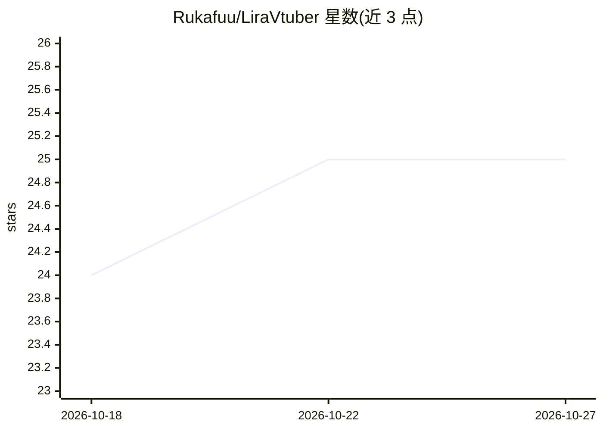

# Rukafuu/LiraVtuber

⭐ 25 · Python · MIT · 推送 2026-10-12 · [GitHub](https://github.com/Rukafuu/LiraVtuber) · 个人维护

**Windows 桌面 AI VTuber 助手：语音对话、混合记忆与桌面控制**

面向 Windows 桌面的开源 VTuber 助手 Lira AM Amarinth：通过 Whisper 语音识别与多家 TTS 提供商（F5-TTS、ElevenLabs、Google、Azure、OpenAI、Edge）进行语音对话，LLM 支持 google_cloud、groq、openrouter、openai、cerebras。记忆采用 SQLite 时间线、向量 RAG 与知识图谱三层结构。支持 XML 标签静默控制桌面（开 URL/应用、读写文件、鼠标键盘）、VTube Studio 联动、图像/音乐生成、视频理解 OCR，以及本地 MCP 网关（Tavily/GitHub/Filesystem/Puppeteer，owner 专用）与 Discord/WhatsApp 机器人。终端为短回复语音模式，GUI 为完整聊天模式。

## 筛选速览

| 维度 | 判定 | 备注 |
|---|---|---|
| AI 角色 | `ai-native` | 本体是模型或模型工具 |
| 许可风险 | `permissive` | MIT |
| 部署形态 | `library` | 以包/库形式分发 |
| 模型依赖 | locked-api |  |
| 硬件要求 | — | 无带数字的原话,不猜 |
| 安装摩擦 | `low` | 无编译、无系统依赖或容器化 |
| 成熟度 | — | 结构信号不足 |

## 能力要点

- Whisper STT + 多提供商 TTS 回退链，F8 全局停止
- SQLite + 向量 RAG + 知识图谱三层混合记忆
- XML 标签静默执行桌面操作，危险命令走 guardrails
- Discord 机器人 13 个模块 + WhatsApp 桥接与 MCP 本地网关

## 适用场景

- 在 Windows 桌面上与带 Live2D 形象的 AI 角色语音对话
- 让助手代为打开应用、读文件、控制音量等桌面操作
- 通过 Discord/WhatsApp 部署为社区管理助手

## 场景标签

`语音 Agent` `GUI 自动化` `聊天机器人` · 领域:效率与自动化

## 证据(README 行号)

> L18: **Lira AM Amarinth** is a VTuber assistant designed to run on the Windows desktop, converse via voice, remember con
> L57: |Voice|STT via Whisper, TTS via F5-TTS / XTTS v2 (Colab), ElevenLabs, Google, Azure, OpenAI and Edge, global stop v
> L59: |Brain|Providers `google_cloud`, `groq`, `openrouter`, `openai` and `cerebras`|

## 星数曲线

2026-10-18 24 → 2026-10-27 25（+1）

---
*卡片 v1 · prompt 1.4 · 生成 2026-10-27 · 置信度 high · 依据 README sha `02a2a4f8df0d` · [字段定义](../../DATASET.md)*
