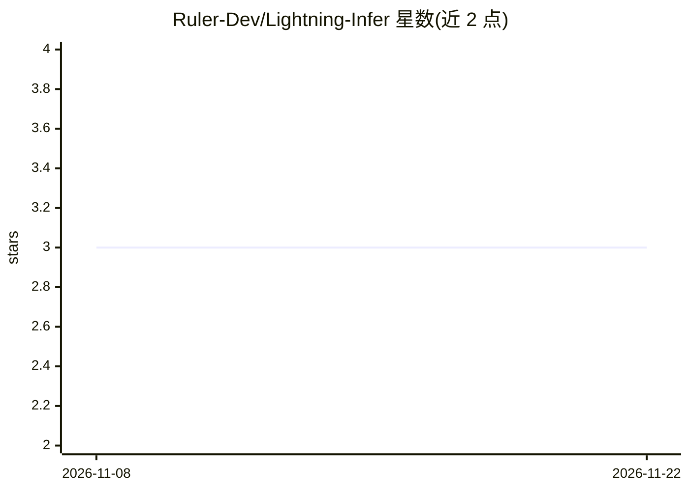

# Ruler-Dev/Lightning-Infer

⭐ 3 · C++ · Apache-2.0 · 推送 2026-11-17 · [GitHub](https://github.com/Ruler-Dev/Lightning-Infer) · 个人维护

**在双消费级 NVIDIA GPU 上本地推理 70GB MoE 模型的引擎**

面向 Qwen3.8-Flash-Next 的本地 C++/CUDA 推理引擎：将模型按层切分到一台 PC 的两张 GPU，专家权重驻留 pinned 系统内存并按对话话题在 VRAM 中缓存，n-gram 表从 NVMe 逐行读取，配合 DFlash2 投机解码。提供 OpenAI/Anthropic 兼容 API 服务器与命令行程序，支持最高 524,288 上下文与图像/视频输入。面向需要在本地硬件上运行超大 MoE 模型的用户。限制：仅原生 Windows，需 Blackwell 架构 GPU、约 71GB 空闲内存与 NVMe 硬盘，需从源码构建。

## 筛选速览

| 维度 | 判定 | 备注 |
|---|---|---|
| AI 角色 | `ai-ecosystem` | LLM/agent 周边工具 |
| 许可风险 | `permissive` | Apache-2.0 |
| 部署形态 | `desktop` | 安装包/桌面程序 |
| 模型依赖 | locked-api |  |
| 硬件要求 | — | 无带数字的原话,不猜 |
| 安装摩擦 | `high` | 编译与系统依赖俱全 |
| 成熟度 | — | 结构信号不足 |

## 能力要点

- 模型按层切分至两张不同型号 GPU，无需 NVLink/P2P，切分输出与单卡 bit-identical
- DFlash2 投机解码与对话内 n-gram 拷贝，draft 均经验证不改变输出
- OpenAI Chat Completions/Responses 与 Anthropic Messages 兼容 API，含 Prometheus /metrics
- 跨请求/子代理的 hybrid prefix cache 与可保存恢复的专家缓存

## 适用场景

- 在本地两张消费级 GPU 上运行无法整体放入显存的 MoE 大模型
- 为本地编码 agent 提供 OpenAI/Anthropic 兼容的推理后端
- 处理 50K-250K 长代码上下文的粘贴与续写任务

## 场景标签

`推理引擎` · 领域:训练与推理

## 证据(README 行号)

> L7: Local C++/CUDA inference engine for **Qwen3.8-Flash-Next**: 110-125 tok/s in coding sessions, peaks above 160 tok/s,
> L42: |**Drop-in APIs**|OpenAI Chat Completions and Responses, Anthropic Messages, Prometheus `/metrics`. Tested with Cod
> L149: **1. Build** (Visual Studio 2022 Build Tools, CUDA 13.3, CMake and Ninja, vcpkg with ffmpeg and curl

## 星数曲线

2026-11-08 3 → 2026-11-22 3（+0）

---
*卡片 v1 · prompt 1.4 · 生成 2026-11-22 · 置信度 high · 依据 README sha `aa83695658ec` · [字段定义](../../DATASET.md)*
