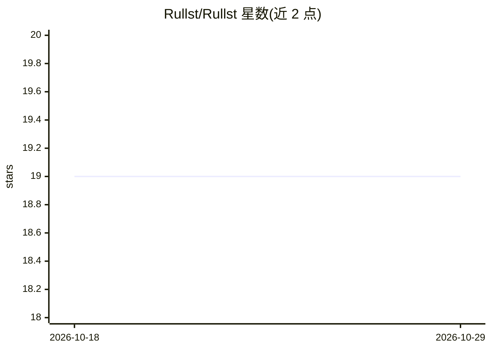

# Rullst/Rullst

⭐ 19 · Rust · MIT · 推送 2026-10-27 · [GitHub](https://github.com/Rullst/Rullst) · [官网](https://rullst.win) · 个人维护

**面向人类与 AI 辅助编码设计的 Rust 全栈 Web 框架**

以 Rust 编写的全栈 Web 框架，工作区拆分为多 crate（核心运行时、ORM、认证、安全中间件等），提供 cargo-rullst CLI 脚手架生成 API/Blog/SaaS/LMS/Portfolio/ERP 六种蓝图，HTML 用编译期 html! 宏、服务端渲染、HTMX-ready，无 JS 打包步骤。安全默认项含 Argon2id、passkeys、OAuth2/OIDC、CSRF、WAF。AI 作为可选 Extension（rullst-ai）内置 OpenAI/Claude/Gemini/DeepSeek/Ollama 客户端，附提示注入过滤与 PII 遮蔽，并声明为 AI 辅助编码优化 API 设计。当前安装的是 13.0.0-alpha.3 预发布版，v12 线已终止维护。

## 筛选速览

| 维度 | 判定 | 备注 |
|---|---|---|
| AI 角色 | `ai-enhanced` | 去掉 AI 部分产品仍成立 |
| 许可风险 | `permissive` | MIT |
| 部署形态 | `library` | 以包/库形式分发 |
| 模型依赖 | local-ok | 支持本地模型 |
| 硬件要求 | — | 无带数字的原话,不猜 |
| 安装摩擦 | `low` | 无编译、无系统依赖或容器化 |
| 成熟度 | — | 结构信号不足 |

## 能力要点

- cargo rullst new 生成六种蓝图（API/Blog/SaaS/LMS/Portfolio/ERP）并热重载开发
- rullst-ai 扩展提供 OpenAI/Claude/Gemini/DeepSeek/Ollama 客户端与提示注入过滤、PII 遮蔽
- 编译期 html! 宏与服务端渲染，无 JavaScript 构建流程
- CI 强制零 panic、≥90% 覆盖率、RustSec/许可策略扫描

## 适用场景

- 用 Rust 快速搭建带认证、计费与邮件的 SaaS 或 LMS 应用
- 构建 HTMX 服务端渲染或 JSON REST API 的 Web 服务
- 在应用内接入多家 LLM 提供商并做安全防护

## 场景标签

 · 领域:Web 开发框架

## 证据(README 行号)

> L86:  One framework, the whole product. Secure by default: Argon2id, sessions, passkeys, OAuth2/OIDC, CSRF, strict heade
> L144: |rullst-ai|Guarded local/cloud clients and tenant-aware retrieval|Extension|

## 星数曲线

2026-10-18 19 → 2026-10-29 19（+0）

---
*卡片 v1 · prompt 1.4 · 生成 2026-10-28 · 置信度 high · 依据 README sha `7b80b833ad26` · [字段定义](../../DATASET.md)*
