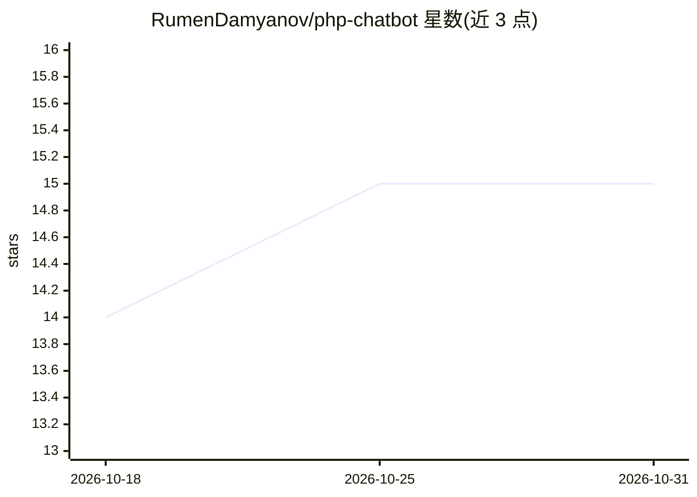

# RumenDamyanov/php-chatbot

⭐ 15 · PHP · MIT · 推送 2026-10-26 · [GitHub](https://github.com/RumenDamyanov/php-chatbot) · 个人维护

**PHP 聊天弹窗组件包：为 Web 应用接入多供应商 AI 对话**

框架无关的 PHP Composer 包，用于向任意 Web 应用添加 AI 聊天弹窗，提供 Laravel 与 Symfony 适配器及最简前端。通过模型抽象契约接入 OpenAI、Anthropic、xAI、Google、Meta、DeepSeek、Ollama 等供应商，支持流式输出、token 与成本追踪、对话记忆（file/Redis/database）、限流、响应缓存与健康监控。安装方式为 composer require，属多语言 chatbot 库家族的 PHP 实现（另有 npm/go 版本）。

## 筛选速览

| 维度 | 判定 | 备注 |
|---|---|---|
| AI 角色 | `ai-ecosystem` | LLM/agent 周边工具 |
| 许可风险 | `permissive` | MIT |
| 部署形态 | `library` | 以包/库形式分发 |
| 模型依赖 | local-ok | 支持本地模型 |
| 硬件要求 | — | 无带数字的原话,不猜 |
| 安装摩擦 | `low` | 无编译、无系统依赖或容器化 |
| 成熟度 | — | 结构信号不足 |

## 能力要点

- 模型抽象契约支持 OpenAI/Anthropic/xAI/Google/Meta/DeepSeek/Ollama，可换模型
- 流式响应（SSE）与 token/成本追踪
- 对话记忆、限流、响应缓存（memory/file/Redis）与健康监控
- Laravel/Symfony 适配器与可自定义前端

## 适用场景

- 为 Laravel/Symfony/原生 PHP 站点添加 AI 客服弹窗
- 按用户/IP 做限流与成本控制地运行站点聊天机器人
- 通过 Ollama 在本地无 API key 运行聊天弹窗

## 场景标签

`聊天机器人` · 领域:对话与助手

## 证据(README 行号)

> L12: **php-chatbot** is a modern, framework-agnostic PHP package for integrating an AI-powered chat popup into any web a
> L43: - AI model abstraction via contracts (swap models easily)

## 星数曲线

2026-10-18 14 → 2026-10-31 15（+1）

---
*卡片 v1 · prompt 1.4 · 生成 2026-10-30 · 置信度 mid · 依据 README sha `5124c2b618b7` · [字段定义](../../DATASET.md)*
