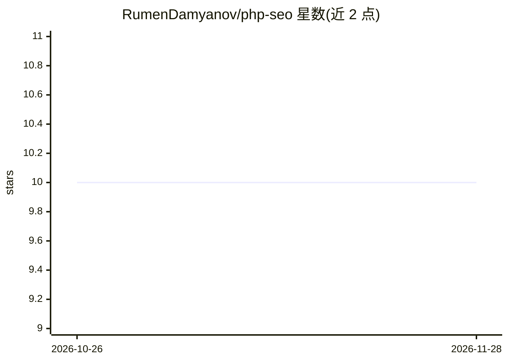

# RumenDamyanov/php-seo

⭐ 10 · PHP · MIT · 推送 2026-10-26 · [GitHub](https://github.com/RumenDamyanov/php-seo) · 个人维护

**面向 PHP 开发者的 AI 生成 SEO 元标签的框架无关库**

PHP 8.3+ 的 Composer 包，读取页面内容后生成标题、描述、meta 标签、图片 alt 文本及 Open Graph/Twitter Cards 社交标签，并生成 Schema.org JSON-LD 结构化数据。提供 AI 模式、手动模式与混合模式，AI 不可用时降级到模板/模式生成。内置 Laravel 服务提供者/Facade/中间件与 Symfony Bundle 集成，也可在任意 PHP 项目使用；支持 PSR-16 缓存以降低 AI API 开销、令牌桶限流与批量处理。

## 筛选速览

| 维度 | 判定 | 备注 |
|---|---|---|
| AI 角色 | `ai-enhanced` | 去掉 AI 部分产品仍成立 |
| 许可风险 | `permissive` | MIT |
| 部署形态 | `None` |  |
| 模型依赖 | local-ok | 支持本地模型 |
| 硬件要求 | — | 无带数字的原话,不猜 |
| 安装摩擦 | `low` | 无编译、无系统依赖或容器化 |
| 成熟度 | — | 结构信号不足 |

## 能力要点

- 支持 OpenAI、Anthropic、Google Gemini、xAI Grok、Ollama 五类 AI 提供商及多提供商回退配置
- AI/手动/混合三种模式，AI 服务不可用时按模式回退生成
- Laravel 与 Symfony 原生集成，PSR-16 缓存与令牌桶限流
- 生成 Schema.org JSON-LD 结构化数据

## 适用场景

- 给 Laravel 或 Symfony 网站自动生成每页的 meta 与社交分享标签
- 批量处理 CMS 中大量文章的 SEO 元数据
- 在 PHP 项目中用本地 Ollama 生成 SEO 文本而不调用云端 API

## 场景标签

`AI 写作` · 领域:内容生成

## 证据(README 行号)

> L10: **php-seo** is a modern, AI-powered, framework-agnostic PHP package for automated SEO optimization. It intelligentl
> L21: ### 🔧 Manual Configuration Mode
> L30: - **Laravel**: Native service provider, facades, config publishing, middleware

## 星数曲线

2026-10-26 10 → 2026-11-28 10（+0）

---
*卡片 v1 · prompt 1.4 · 生成 2026-11-20 · 置信度 high · 依据 README sha `432a22ca69a7` · [字段定义](../../DATASET.md)*
