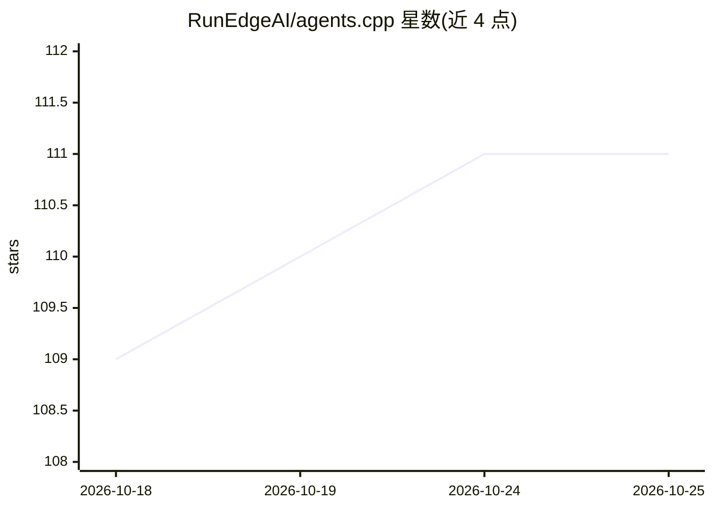

# RunEdgeAI/agents.cpp

⭐ 111 · C++ · NOASSERTION · 推送 2026-08-18 · [GitHub](https://github.com/RunEdgeAI/agents.cpp) · [官网](https://www.runedge.ai/) · 组织维护

**面向边缘设备的 C++ AI Agent 构建框架**

用 C++20 编写的 AI Agent 框架，面向在端侧设备上构建本地优先的智能体系统，支持 OpenAI、Anthropic Claude、Google Gemini、Ollama/llama-cpp 等多种 LLM 提供商接入。内置提示链、路由、并行化、编排者-工作者、评估者-优化器等工作流模式，以及 ReAct、Plan and Execute 等推理策略，提供 Web Search、Wikipedia、Python 执行器等工具并可扩展自定义工具与工作流。使用 Bazel 构建，需 C++20 编译器（GCC 14+/Clang 17+/MSVC 2022+）。README 末尾宣传含 MCP、语音 SDK 等功能的 Pro 商业版本，项目采用 evaluation License。

## 筛选速览

| 维度 | 判定 | 备注 |
|---|---|---|
| AI 角色 | `ai-ecosystem` | LLM/agent 周边工具 |
| 许可风险 | `none` | NOASSERTION |
| 部署形态 | `None` |  |
| 模型依赖 | local-ok | 支持本地模型 |
| 硬件要求 | — | 无带数字的原话,不猜 |
| 安装摩擦 | `medium` | 含编译或系统依赖之一 |
| 成熟度 | `idea` | |

## 能力要点

- 多 LLM 提供商接入：OpenAI/Anthropic/Google/Ollama/llama-cpp
- 内置提示链、路由、并行化、编排-工作者、评估-优化等工作流模式
- ReAct/Plan and Execute/Zero-Shot 等推理策略（CoT、Reflexion 开发中）
- C++ 实现面向端侧实时低开销运行

## 适用场景

- 在边缘/端侧设备上构建本地优先的 AI Agent 应用
- 通过组合工作流模式与工具构建多 Agent 系统
- 在离线或低资源环境运行基于本地模型的推理 Agent

## 场景标签

`Agent 框架` · 领域:Agent 开发

## 证据(README 行号)

> L8: **Agents-SDK** is a **portable, high-performance C++ framework** for building **on-device, agentic AI systems** — th
> L17:  - **Ollama/llama-cpp** (local models like Llama, Mistral, etc.)
> L209:  - `llm_interface.h`: Interface for LLM providers

## 星数曲线

2026-10-18 109 → 2026-10-25 111（+2）

---
*卡片 v1 · prompt 1.4 · 生成 2026-10-23 · 置信度 high · 依据 README sha `9da3d358673d` · [字段定义](../../DATASET.md)*
