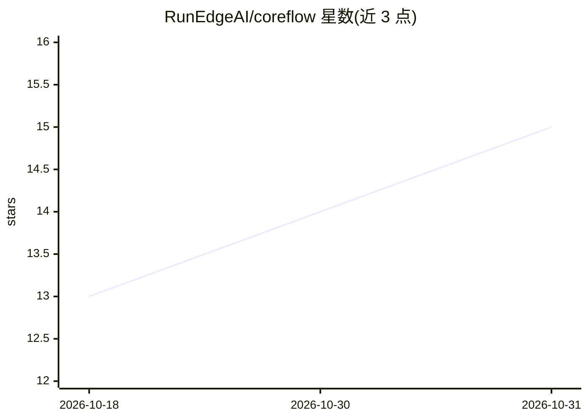

# RunEdgeAI/coreflow

⭐ 15 · C++ · NOASSERTION · 推送 2026-06-29 · [GitHub](https://github.com/RunEdgeAI/coreflow) · [官网](https://www.runedge.ai) · 组织维护

**C++ 图执行运行时：构建并跨设备运行 AI/ML/视觉管线**

面向 AI、ML 与计算机视觉应用的图执行运行时：以 DAG 建模管线，节点为处理操作、边定义数据流，内核为可运行算法；提供可视化无代码图构建 UI 与 C++ API，支持 ARM/x86 跨平台及 CPU、GPU 与专用硬件加速。内置 ONNX Runtime、TensorFlow Lite、ExecuTorch 模型运行支持与模型加载切换。README 未给出安装命令或构建步骤；许可证声明为专有（confidential/proprietary），需查看 LICENSE 文件。

## 筛选速览

| 维度 | 判定 | 备注 |
|---|---|---|
| AI 角色 | `ai-ecosystem` | LLM/agent 周边工具 |
| 许可风险 | `none` | NOASSERTION |
| 部署形态 | `None` |  |
| 模型依赖 | — | README 未给出锁定关系 |
| 硬件要求 | — | 无带数字的原话,不猜 |
| 安装摩擦 | `low` | 无编译、无系统依赖或容器化 |
| 成熟度 | — | 结构信号不足 |

## 能力要点

- DAG 图执行模型（Graphs/Nodes/Edges/Kernels/Targets）
- 内置 ONNX Runtime、TensorFlow Lite、ExecuTorch 支持
- 支持 CPU、GPU 与专用硬件加速及流式/流水线优化
- 无代码可视化图构建 UI 与 C++ API

## 适用场景

- 用图形界面搭建 AI/视觉处理管线并部署到 ARM/x86 设备
- 在自有应用中嵌入 C++ 图执行运行时处理实时数据流
- 通过自定义内核扩展管线处理能力

## 场景标签

`推理引擎` · 领域:训练与推理

## 证据(README 行号)

> L12: **CoreFlow** is a modern, high-performance graph execution runtime designed for AI, ML, and computer vision applica
> L31: - **ONNX Runtime**: Deploy models using Open Neural Network Exchange

## 星数曲线

2026-10-18 13 → 2026-10-31 15（+2）

---
*卡片 v1 · prompt 1.4 · 生成 2026-10-31 · 置信度 mid · 依据 README sha `d7d8f05352a5` · [字段定义](../../DATASET.md)*
