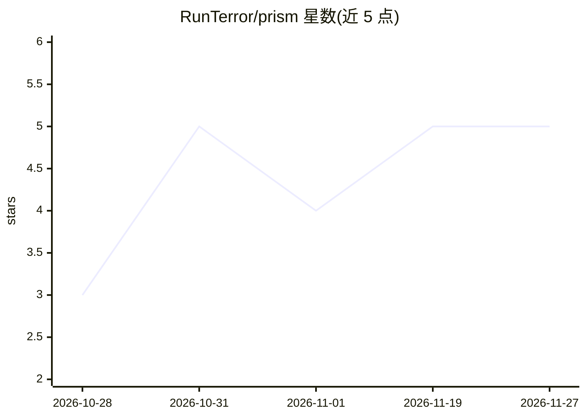

# RunTerror/prism

⭐ 5 · JavaScript · Apache-2.0 · 推送 2026-10-30 · [GitHub](https://github.com/RunTerror/prism) · [官网](https://runterror.github.io/prism/#/components) · 个人维护

**让 App 内 AI 以原生界面回答的 generative-UI 工具包**

Prism 为应用开发者提供一套 generative-UI 机制：向自己接入的 AI 额外提供 show_screen 工具，AI 生成类 React 代码，Prism 在服务端校验并编译为 JSON envelope，App 内 SDK 在沙箱中运行并以 iOS/Android/Web 原生控件绘制界面，样式跟随应用设计系统。Prism 本身不调用任何 AI、无需 API key；代码沙箱禁止网络与设备访问，死循环会被终止。提供 Node 服务端包、Swift/Gradle 移动端包与 React Web 版。

## 筛选速览

| 维度 | 判定 | 备注 |
|---|---|---|
| AI 角色 | `ai-ecosystem` | LLM/agent 周边工具 |
| 许可风险 | `permissive` | Apache-2.0 |
| 部署形态 | `library` | 以包/库形式分发 |
| 模型依赖 | locked-api |  |
| 硬件要求 | — | 无带数字的原话,不猜 |
| 安装摩擦 | `low` | 无编译、无系统依赖或容器化 |
| 成熟度 | `idea` | |

## 能力要点

- AI 通过 show_screen 工具生成界面代码，服务端校验后编译为 JSON envelope
- SDK 沙箱运行：无网络、无设备访问、死循环终止
- 32 个组件分核心与 teach/ask/act 可选包，界面跟随应用主题与明暗模式
- 支持 Anthropic、OpenAI、MCP 等接入方式及流式部分渲染

## 适用场景

- 聊天助手的回答以计算器、对比卡片、预订确认等可交互界面呈现
- 让 AI 回答界面对齐自家 App 的设计系统与原生控件
- 在 AI 执行操作前用 Confirm 组件向用户请求确认

## 场景标签

`聊天机器人` `AI 助手` · 领域:对话与助手

## 证据(README 行号)

> L3: **Prism lets the AI in your app answer with small working screens, not just text, and they look like the rest of you
> L24: 1. **You give your AI one extra tool**, called `show_screen`, plus a page of instructions that teach it the parts i
> L30: - **Prism never talks to an AI itself and needs no API key.** You keep using your own AI and account; Prism is a to

## 星数曲线

2026-10-28 3 → 2026-11-27 5（+2）

---
*卡片 v1 · prompt 1.4 · 生成 2026-11-21 · 置信度 high · 依据 README sha `de5b75d23a06` · [字段定义](../../DATASET.md)*
