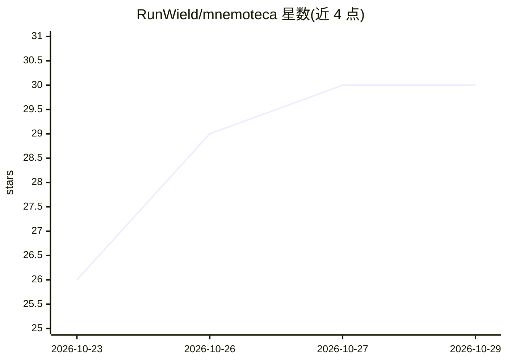

# RunWield/mnemoteca

⭐ 30 · Go · MIT · 推送 2026-10-21 · [GitHub](https://github.com/RunWield/mnemoteca) · 个人维护

**本地优先的 agent 记忆存储检索 CLI，混合搜索无云端依赖**

用 Go 编写的本地文档存储与检索命令行工具：以 SQLite 存储记忆，通过向量相似度（sqlite-vec 余弦）加 BM25 词法融合及可选本地 cross-encoder 重排进行混合检索；嵌入与重排模型全部经 ONNX Runtime 本地推理，setup 命令自动下载 Jina v5 nano 模型，无需云 API 与 HuggingFace 账号。面向 agent 开发者，提供 Claude Code / OpenCode / Pi 集成及 AGENTS.md 指令块，支持 JSONL 导入导出、JSON 检索输出，并内置 BEIR SciFact 与 LongMemEval 基准测试工具（README 报告的数字来自改名前 Mnemosyne 的运行结果）。

## 筛选速览

| 维度 | 判定 | 备注 |
|---|---|---|
| AI 角色 | `ai-ecosystem` | LLM/agent 周边工具 |
| 许可风险 | `permissive` | MIT |
| 部署形态 | `desktop` | 安装包/桌面程序 |
| 模型依赖 | — | README 未给出锁定关系 |
| 硬件要求 | — | 无带数字的原话,不猜 |
| 安装摩擦 | `low` | 无编译、无系统依赖或容器化 |
| 成熟度 | — | 结构信号不足 |

## 能力要点

- SQLite 存储 + sqlite-vec 向量检索 + FTS5 BM25 的混合搜索
- ONNX Runtime 全本地推理，setup 幂等自动下载 Jina v5 nano 模型
- Claude Code / OpenCode / Pi 集成，共享同一本地记忆集合
- 内置 BEIR SciFact 与 LongMemEval 基准测试 harness

## 适用场景

- 给 coding agent 接入跨会话的本地记忆系统
- 在无云端依赖的前提下做语义+词法混合检索
- 用 JSONL 导出导入备份或迁移记忆数据
- 复现或评估记忆系统的检索基准表现

## 场景标签

`Agent 记忆` · 领域:Agent 开发

## 证据(README 行号)

> L7: Mnemoteca is a local document storage and retrieval CLI built in Go. Store short
> L105: ## Connect Mnemoteca to your agent

## 星数曲线

2026-10-23 26 → 2026-10-29 30（+4）

---
*卡片 v1 · prompt 1.4 · 生成 2026-10-26 · 置信度 high · 依据 README sha `bf7d4f42821c` · [字段定义](../../DATASET.md)*
