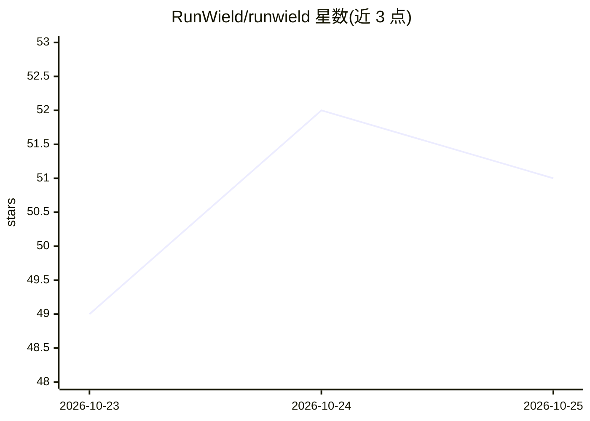

# RunWield/runwield

⭐ 52 · TypeScript · MIT · 推送 2026-10-25 · [GitHub](https://github.com/RunWield/runwield) · [官网](https://docs.runwield.dev/) · 个人维护

**面向开发者的 AI 编码代理框架：先审计划再动代码**

RunWield 是一个 MIT 开源的本地 AI 编码代理框架（harness），核心流程为 ideate→plan→execute→record：Router 将请求分为六类意图，非平凡变更由 Planner 先写计划、开发者在浏览器 UI 中审批，Engineer 在隔离 git worktree 中执行，随后运行真实 CI、由独立 Reviewer 做计划-差异语义审查，最终由 Git 验证落地分支。每个完成的计划生成 Work Record 与项目记忆（纯 markdown 存于仓库）。以单个编译二进制分发，CLI+TUI+浏览器 Workspace+ACP 服务器，任意模型供应商可用，macOS/Linux 安装。

## 筛选速览

| 维度 | 判定 | 备注 |
|---|---|---|
| AI 角色 | `ai-ecosystem` | LLM/agent 周边工具 |
| 许可风险 | `permissive` | MIT |
| 部署形态 | `library` | 以包/库形式分发 |
| 模型依赖 | — | README 未给出锁定关系 |
| 硬件要求 | — | 无带数字的原话,不猜 |
| 安装摩擦 | `low` | 无编译、无系统依赖或容器化 |
| 成熟度 | `idea` | |

## 能力要点

- 六类意图分诊，仪式感随风险缩放
- 计划先审批后执行，浏览器内评论/修改/批准
- CI 验证+独立 Reviewer 多轮语义审查+Git 落地验证
- Work Record/PRD/ADR 以纯 markdown 存于仓库，可 grep 可版本化

## 适用场景

- 在高风险代码库上让 AI 变更先经计划审批再做
- 审查并追踪 AI 代理的执行结果与验证记录
- 跨会话沉淀项目记忆，避免重复踩坑

## 场景标签

`编码 Agent` · 领域:编码与开发

## 证据(README 行号)

> L9: they were building. RunWield fixes that. It's a senior tech lead in a box: it reads your repo, writes a plan you app
> L40: First run asks you to connect a model — a subscription login or your own API key. RunWield works with any provider.
> L113: Most agent tools are organized around tickets and chat sessions. They help teams run many agents and manage contex

## 星数曲线

2026-10-23 49 → 2026-10-25 51（+2）

---
*卡片 v1 · prompt 1.4 · 生成 2026-10-24 · 置信度 mid · 依据 README sha `c186a1dd4d10` · [字段定义](../../DATASET.md)*
