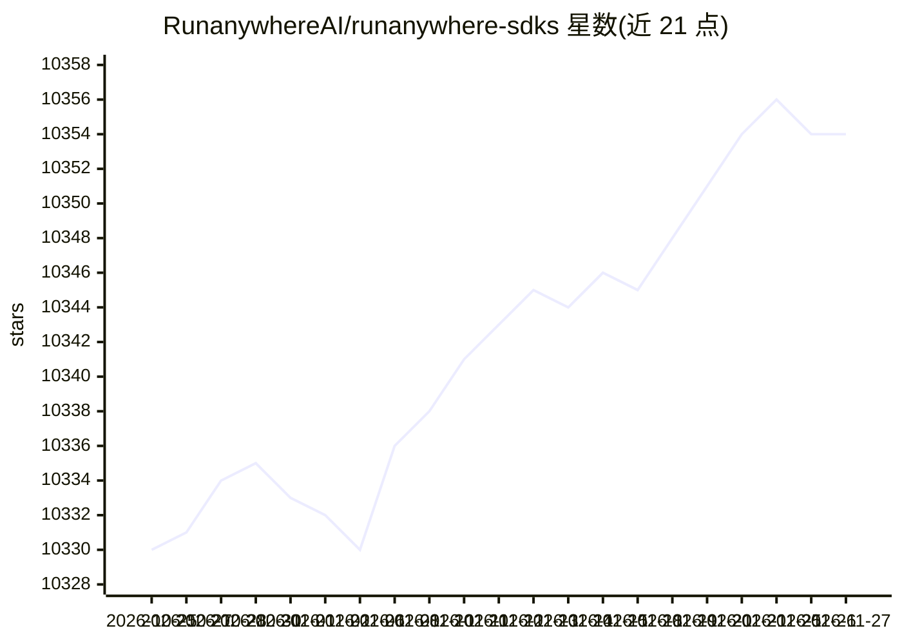

# RunanywhereAI/runanywhere-sdks

⭐ 10,354 · C++ · NOASSERTION · 推送 2026-11-10 · [GitHub](https://github.com/RunanywhereAI/runanywhere-sdks) · [官网](https://www.runanywhere.ai) · 组织维护

**面向开发者的端侧本地 AI 推理 SDK 套件**

以一个 C++ 核心（runanywhere-commons）承载八个平台 SDK（Swift/Kotlin/Flutter/React Native/Web/Electron/Python/wally），提供 LLM 对话、VLM、语音识别/合成、语音代理流水线、嵌入、RAG、结构化输出、工具调用与图像生成等能力，全部在设备本地运行。核心机制是能力注册表：各推理引擎声明可运行项，推理时按设备自动选择最高优先级引擎（QHexRT/MLX/llama.cpp/sherpa+ONNX/Core ML）。各 SDK 处于 Stable 到 Alpha 不同阶段，部分功能标注 Stub/Gated/Partial，需调用 capabilities() 探测实际可用性。

## 筛选速览

| 维度 | 判定 | 备注 |
|---|---|---|
| AI 角色 | `ai-ecosystem` | LLM/agent 周边工具 |
| 许可风险 | `none` | NOASSERTION |
| 部署形态 | `library` | 以包/库形式分发 |
| 模型依赖 | local-ok | 支持本地模型 |
| 硬件要求 | — | 无带数字的原话,不猜 |
| 安装摩擦 | `medium` | 含编译或系统依赖之一 |
| 成熟度 | `idea` | |

## 能力要点

- 一个语义 API 覆盖八个平台 SDK，统一 C++ 核心与 C ABI
- 能力注册表按设备自动路由到 QHexRT、MLX、llama.cpp、sherpa+ONNX、Core ML 等引擎
- 支持 LoRA 适配器、结构化输出与工具调用
- Connect 功能支持 macOS 主机向 iOS/iPadOS/Android 客户端在局域网共享已加载模型

## 适用场景

- 在手机 App 中离线运行 LLM 对话与语音代理
- 在浏览器中通过 WASM+WebGPU 运行本地推理
- 在 Snapdragon Hexagon NPU 上部署端侧模型推理
- 搭建本地 OpenAI 兼容 API 服务（wally serve）

## 场景标签

`推理引擎` `RAG` `语音识别` `图像生成` · 领域:内容生成

## 证据(README 行号)

> L16:  Eight SDKs, one C++ core. A capability registry routes every call to the best engine on the device,
> L303: Every SDK is a thin binding over `runanywhere-commons`, a single C++ core behind a pure C ABI. Engines plug into a
> L251: All SDKs ship on one version line, currently **0.20.37**, from a single C++ core. Pin the same version across the 

## 星数曲线

2026-10-25 10,330 → 2026-11-27 10,354（+24）

---
*卡片 v1 · prompt 1.4 · 生成 2026-11-22 · 置信度 high · 依据 README sha `8242dfab9ca9` · [字段定义](../../DATASET.md)*
