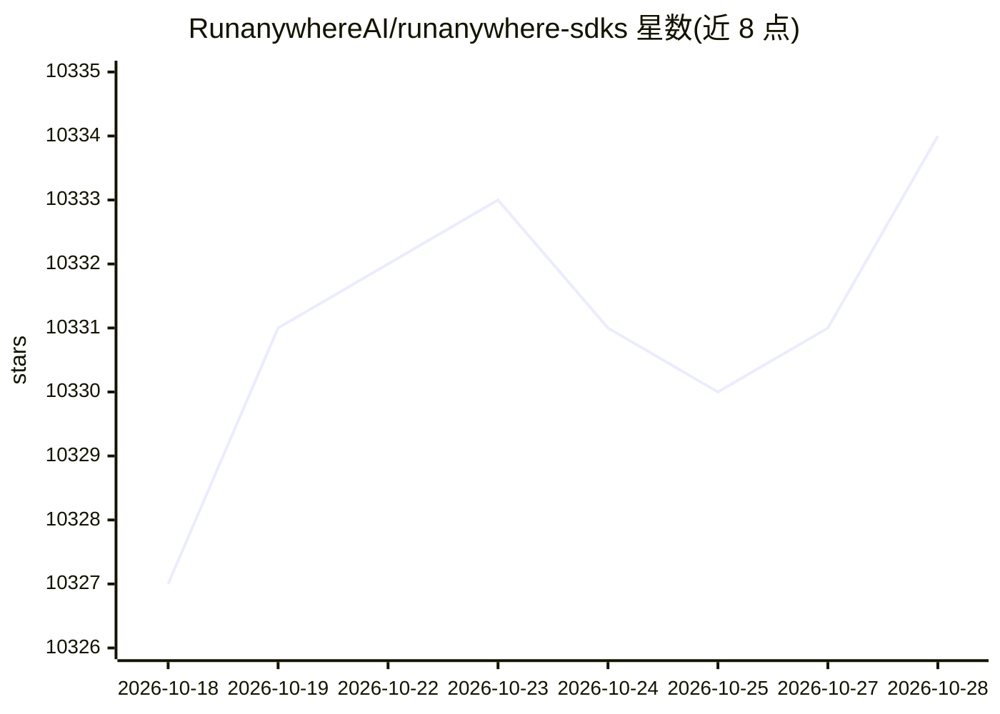

# RunanywhereAI/runanywhere-sdks

⭐ 10,334 · C++ · NOASSERTION · 推送 2026-10-28 · [GitHub](https://github.com/RunanywhereAI/runanywhere-sdks) · [官网](https://www.runanywhere.ai) · 组织维护

**跨平台本地 AI SDK 套件：一套 C++ 核心跑 LLM/语音/视觉/RAG**

RunAnywhere 提供覆盖 Swift/Kotlin/Flutter/React Native/Web/Electron/Python/CLI 的八个 SDK，均基于单一 C++ 核心（runanywhere-commons，纯 C ABI）。能力注册表按设备将调用路由到 QHexRT（骁龙 Hexagon NPU）、MLX（Apple 芯片）、llama.cpp、sherpa+ONNX 或 Core ML。功能包括 LLM 对话、结构化输出、工具调用、VLM、STT/TTS/语音管线、嵌入、本地 RAG 与扩散图像生成，另有 wally CLI 提供 OpenAI 兼容服务。各 SDK 成熟度不一（Stable 到 Alpha/Preview），Connect 局域网共享无 TLS/配对。

## 筛选速览

| 维度 | 判定 | 备注 |
|---|---|---|
| AI 角色 | `ai-ecosystem` | LLM/agent 周边工具 |
| 许可风险 | `none` | NOASSERTION |
| 部署形态 | `library` | 以包/库形式分发 |
| 模型依赖 | local-ok | 支持本地模型 |
| 硬件要求 | — | 无带数字的原话,不猜 |
| 安装摩擦 | `medium` | 含编译或系统依赖之一 |
| 成熟度 | `idea` | |

## 能力要点

- 八个 SDK 共享一套语义 API 与单一 C++ 核心
- 能力注册表按设备路由到 NPU/MLX/llama.cpp/ONNX/Core ML 引擎
- 覆盖 LLM、VLM、STT/TTS、嵌入、RAG、扩散图像生成等模态
- wally CLI 可启动 OpenAI 兼容本地服务（:8080）

## 适用场景

- 在移动 App 中集成离线 LLM 对话与语音管线
- 构建本地 RAG 问答与嵌入检索应用
- 用同一套代码在 iOS/Android/桌面/浏览器部署端侧 AI

## 场景标签

`推理引擎` `RAG` `多模态` · 领域:知识与检索

## 证据(README 行号)

> L14:  RunAnywhere architecture: eight SDKs over one C++ core, a capability registry that routes to QHexRT, MLX, llama.cp
> L16:  Eight SDKs, one C++ core. A capability registry routes every call to the best engine on the device,
> L303: Every SDK is a thin binding over `runanywhere-commons`, a single C++ core behind a pure C ABI. Engines plug into a

## 星数曲线

2026-10-18 10,327 → 2026-10-28 10,334（+7）

---
*卡片 v1 · prompt 1.4 · 生成 2026-10-20 · 置信度 high · 依据 README sha `e8961e49ea6b` · [字段定义](../../DATASET.md)*
