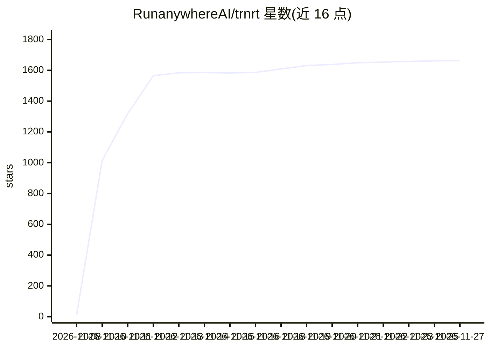

# RunanywhereAI/trnrt

⭐ 1,663 · Python · Apache-2.0 · 推送 2026-11-26 · [GitHub](https://github.com/RunanywhereAI/trnrt) · [官网](https://runanywhere.ai/blog/glm-5-3-flash-trainium2-nki-megakernels) · 组织维护

**面向 AWS Trainium 的开源 LLM 推理引擎**

TrnRT 是在 AWS Trainium 上运行的开源大语言模型推理引擎，提供 OpenAI 兼容 API，从单个 trn2.48xlarge 实例服务；解码以 NKI megakernels 方式执行（约每半层一个内核），并在设备与主机内存间维护前缀缓存。通过离线编译流程在 CPU 主机上构建计算图，服务节点默认不再编译。支持延迟/均衡/吞吐三种构建档位、会话亲和路由、结构化输出与多种调度策略。首个支持的模型为 GLM-5.3-Flash，更多开源模型待加入；本版本设备端端到端运行尚待验证。

## 筛选速览

| 维度 | 判定 | 备注 |
|---|---|---|
| AI 角色 | `ai-ecosystem` | LLM/agent 周边工具 |
| 许可风险 | `permissive` | Apache-2.0 |
| 部署形态 | `self-host` | docker 或自建部署 |
| 模型依赖 | — | README 未给出锁定关系 |
| 硬件要求 | — | 无带数字的原话,不猜 |
| 安装摩擦 | `low` | 无编译、无系统依赖或容器化 |
| 成熟度 | `idea` | |

## 能力要点

- NKI megakernels 解码：KDA 注意力、融合 DSA 层、MoE FFN 每半层单内核
- 1M-token 上下文（稀疏注意力 top-2048 + 线性注意力）与 FP8 KV 前缀缓存（含主机内存分层）
- OpenAI chat/completions/Responses、Anthropic Messages、原生 /generate 与 /tokenize API
- latency/balanced/throughput 三种构建档位，--preset auto 按 --users 选择

## 适用场景

- 在 trn2.48xlarge 上以 OpenAI 兼容 API 服务 GLM-5.3-Flash
- 运行编码 agent 会话类长上下文推理负载
- 离线编译缓存后在设备上部署推理服务

## 场景标签

`推理引擎` · 领域:训练与推理

## 证据(README 行号)

> L17: **TrnRT** is an open inference engine for large language models on AWS Trainium. It serves an OpenAI-compatible API
> L71: |**Agent-ready APIs**|OpenAI chat, completions and Responses, the Anthropic Messages API, the native `/generate` an

## 星数曲线

2026-11-08 12 → 2026-11-27 1,663（+1,651）

---
*卡片 v1 · prompt 1.4 · 生成 2026-11-26 · 置信度 high · 依据 README sha `7b37699df0a9` · [字段定义](../../DATASET.md)*
