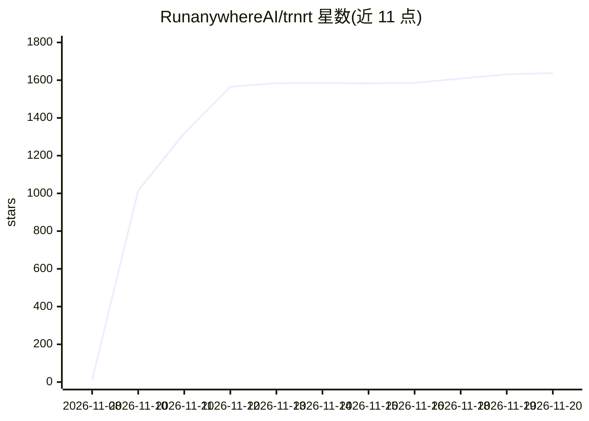

# RunanywhereAI/trnrt

⭐ 1,638 · Python · Apache-2.0 · 推送 2026-11-18 · [GitHub](https://github.com/RunanywhereAI/trnrt) · [官网](https://runanywhere.ai/blog/glm-5-3-flash-trainium2-nki-megakernels) · 组织维护

**AWS Trainium 上的开源 LLM 推理引擎，OpenAI 兼容 API**

TrnRT 是面向 AWS Trainium2（trn2.48xlarge）的开源大模型推理引擎：将 decode 实现为 NKI megakernel（约每半个层一个融合核），支持稀疏+线性注意力的 1M token 上下文、FP8 KV 页的 radix 前缀缓存（含主机内存层），单机跑两个引擎、会话亲和路由，对外提供 OpenAI 兼容 API。首个支持模型为 GLM-5.3-Flash。部署需 Docker，编译缓存可在任意 x86_64 主机离线构建（耗时数小时），服务需在 Trainium2 实例上运行。

## 筛选速览

| 维度 | 判定 | 备注 |
|---|---|---|
| AI 角色 | `ai-ecosystem` | LLM/agent 周边工具 |
| 许可风险 | `permissive` | Apache-2.0 |
| 部署形态 | `self-host` | docker 或自建部署 |
| 模型依赖 | — | README 未给出锁定关系 |
| 硬件要求 | — | 无带数字的原话,不猜 |
| 安装摩擦 | `low` | 无编译、无系统依赖或容器化 |
| 成熟度 | — | 结构信号不足 |

## 能力要点

- NKI megakernel 执行 decode（KDA 注意力、融合 DSA 层、MoE FFN）
- 1M token 上下文：稀疏注意力（top 2,048）+ 线性注意力，固定大小状态
- FP8 KV 页 radix 前缀缓存，跨设备与主机内存
- OpenAI 兼容 API：chat/completions、流式、工具调用与推理输出

## 适用场景

- 在单台 trn2.48xlarge 上自托管 GLM-5.3-Flash 推理服务
- 用现有 OpenAI 客户端接入 Trainium 上的长上下文模型
- 运行多并发 agent 会话并复用前缀缓存

## 场景标签

`推理引擎` · 领域:训练与推理

## 证据(README 行号)

> L17: **TrnRT** is an open inference engine for large language models on AWS Trainium. It serves an OpenAI-compatible API
> L18: from one `trn2.48xlarge`, runs decode as NKI megakernels (about one kernel per layer half), and keeps a prefix cach
> L33: |**OpenAI API**|Chat and completions, streaming, tool calls and reasoning output.|

## 星数曲线

2026-11-08 12 → 2026-11-20 1,638（+1,626）

---
*卡片 v1 · prompt 1.4 · 生成 2026-11-17 · 置信度 high · 依据 README sha `e11d694a3484` · [字段定义](../../DATASET.md)*
