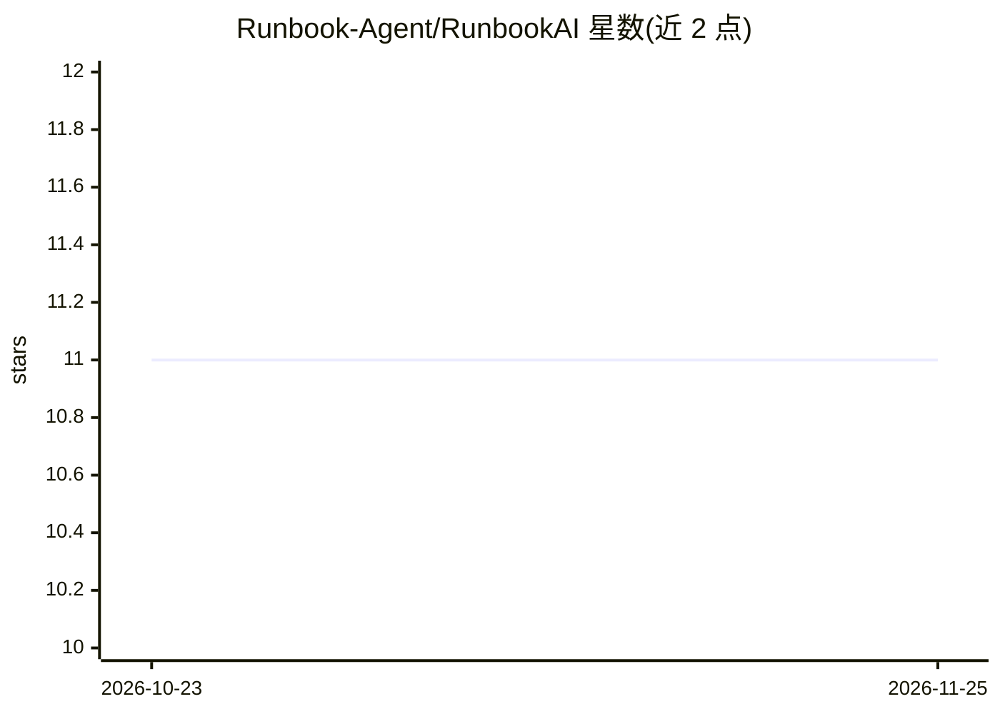

# Runbook-Agent/RunbookAI

⭐ 11 · TypeScript · 推送 2026-03-02 · [GitHub](https://github.com/Runbook-Agent/RunbookAI) · [官网](https://userunbook.ai) · 组织维护

**面向 SRE 的告警根因假设驱动调查 agent**

以 CLI 形式发布的运维事件调查工具：从 PagerDuty/OpsGenie 事件出发，按假设生成、证据查询、分支/剪枝的流程定位根因并给出置信度与修复建议，变更类操作需审批门并附回滚指引。知识检索读取团队的 runbook、postmortem 与架构笔记，支持 Google Drive 同步与团队共享知识服务器（含 admin UI 与 MCP 端点）。可输出复盘草稿与知识更新建议，并提供 RCAEval/Rootly/TraceRCA 基准评测入口。需 Node.js 20+，配置 Anthropic API key 后使用。

## 筛选速览

| 维度 | 判定 | 备注 |
|---|---|---|
| AI 角色 | `ai-native` | 本体是模型或模型工具 |
| 许可风险 | `none` | — |
| 部署形态 | `library` | 以包/库形式分发 |
| 模型依赖 | locked-api |  |
| 硬件要求 | — | 无带数字的原话,不猜 |
| 安装摩擦 | `low` | 无编译、无系统依赖或容器化 |
| 成熟度 | — | 结构信号不足 |

## 能力要点

- 假设驱动调查流程：生成假设→定向查询→分支剪枝→根因置信度
- 敏感操作审批门，Kubernetes 默认只读，全程审计日志
- Claude Code 集成：上下文注入、危险命令拦截、MCP server
- 团队共享知识服务器与 Slack 网关接入

## 适用场景

- on-call 工程师收到 PagerDuty 告警后快速定位可能根因
- 团队把 runbook 与 postmortem 沉淀为可检索的运维知识库
- 在 Claude Code 调试会话中自动注入相关 runbook 上下文
- 对调查流程在 RCAEval 等数据集上跑基准评测

## 场景标签

`模型评测` `知识库管理` `RAG` · 领域:评测与运维

## 证据(README 行号)

> L10: RunbookAI helps on-call engineers go from alert to likely root cause faster with hypothesis-driven investigation, r
> L12: Built for SRE and platform teams operating AWS and Kubernetes who need speed without losing auditability.
> L86: - Hypothesis-driven incident investigation with branch/prune logic.

## 星数曲线

2026-10-23 11 → 2026-11-25 11（+0）

---
*卡片 v1 · prompt 1.4 · 生成 2026-11-18 · 置信度 high · 依据 README sha `b5e63ebc21ec` · [字段定义](../../DATASET.md)*
