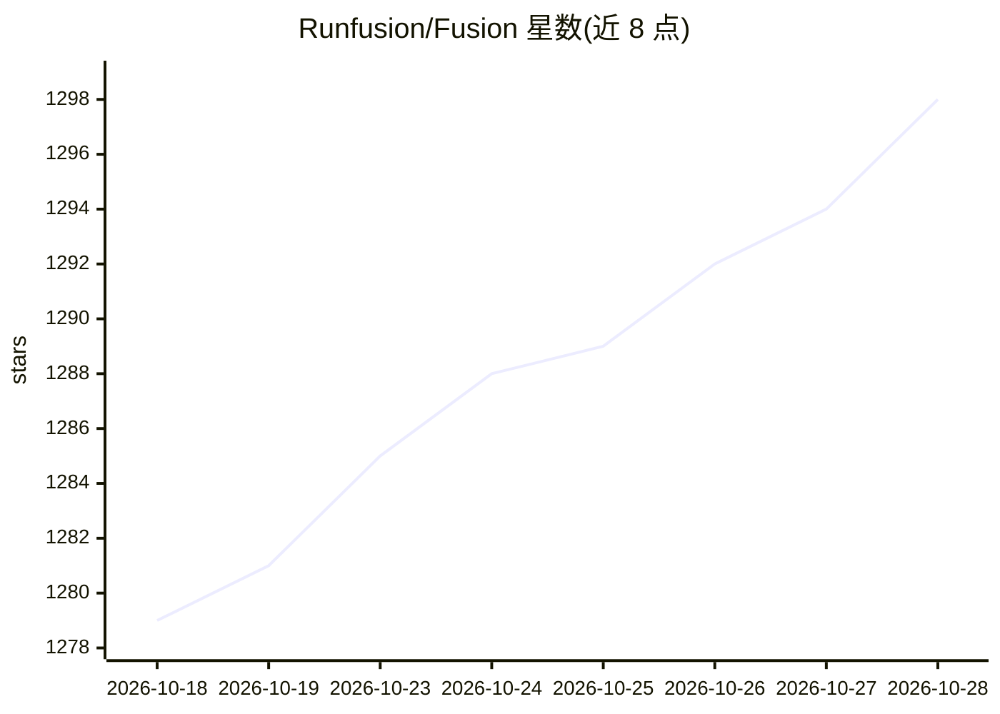

# Runfusion/Fusion

⭐ 1,300 · TypeScript · MIT · 推送 2026-10-26 · [GitHub](https://github.com/Runfusion/Fusion) · [官网](http://runfusion.ai) · 组织维护 · 中文 README

**多 agent 编排软件工厂：用 AI agent 团队自动规划、编写、评审并交付代码**

面向开发者的多 agent 编排系统：以自然语言描述任务，规划 agent 读取项目并生成 PROMPT.md 计划，随后在隔离的 git worktree 中按工作流（规划→评审→执行→评审）运行，支持人工审批门控。提供看板、任务依赖图、agent 花名册、任务间消息与聊天、多节点同步（笔记本/服务器/手机）及含 token 消耗与异常检测的 Command Center。支持 Anthropic、OpenAI、Ollama 等多种模型。通过 npm、Homebrew、curl 安装脚本或源码克隆安装，内嵌零配置 PostgreSQL，MIT 开源。

## 筛选速览

| 维度 | 判定 | 备注 |
|---|---|---|
| AI 角色 | `ai-ecosystem` | LLM/agent 周边工具 |
| 许可风险 | `permissive` | MIT |
| 部署形态 | `library` | 以包/库形式分发 |
| 模型依赖 | local-ok | 支持本地模型 |
| 硬件要求 | — | 无带数字的原话,不猜 |
| 安装摩擦 | `low` | 无编译、无系统依赖或容器化 |
| 成熟度 | — | 结构信号不足 |

## 能力要点

- 自然语言任务 → PROMPT.md 计划 → 隔离 worktree 中执行评审的工作流
- 多模型接入：Anthropic、OpenAI、Ollama、Google、本地运行时及自定义 provider
- 多节点 mesh：笔记本、服务器、云 VM、手机同步同一任务板
- 可导入 440+ agent、16 家预置 agent 公司团队自主运行

## 适用场景

- 用自然语言描述需求，让 agent 团队完成规划、编码、评审到合并
- 并行管理多个开发任务并实时查看 diff 与评审结果
- 监控 agent 团队的 token 消耗、产出与运行健康度

## 场景标签

`多智能体` `编码 Agent` · 领域:Agent 开发

## 证据(README 行号)

> L7: Describe what you want — a team of AI agents **plans, builds, reviews, and ships** it for you. Fusion is your softwa
> L124: |🧩 **Any model**|Anthropic, OpenAI, Ollama, Google Generative AI, Z.ai, Kimi K3, local runtimes, and user-defined 

## 星数曲线

2026-10-18 1,279 → 2026-10-28 1,298（+19）

---
*卡片 v1 · prompt 1.4 · 生成 2026-10-21 · 置信度 high · 依据 README sha `56a3dd993416` · [字段定义](../../DATASET.md)*
