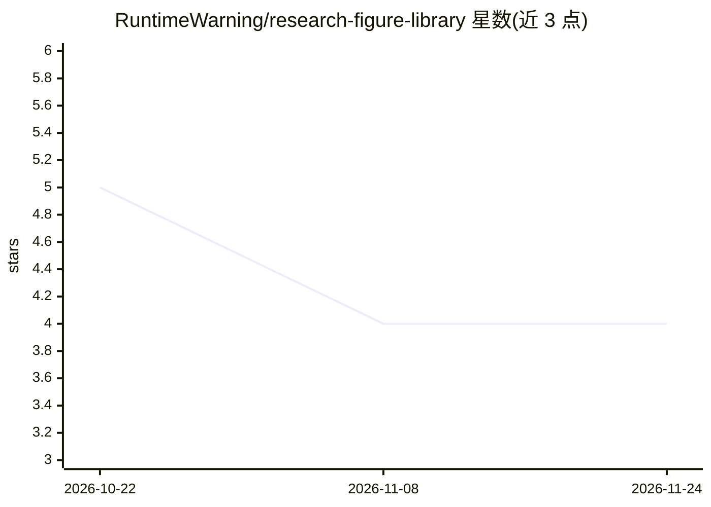

# RuntimeWarning/research-figure-library

⭐ — · [GitHub]() · 个人维护 · 中文 README

**画深度学习模型结构图的图元素材库与检索站**

一个面向科研绘图人员的素材集合与静态检索站点：收录 1,084 个可编辑 SVG 图元（原创、计算机视觉示意、收集的开源物件）、289 张从 216 篇论文自动裁剪的原图、28,102 个开源科研图标，支持中英文搜索、25 类图元分类、图标改色导出、BibTeX 复制与 URL 分享。全站为静态文件，本地仅需 Python 3.9 运行内置服务，无后端。每项素材附来源、许可与 SHA-256 记录；论文原图权利归原作者，使用需引用原文。

## 筛选速览

| 维度 | 判定 | 备注 |
|---|---|---|
| AI 角色 | `ai-knowledge` | 知识聚合/清单类 |
| 许可风险 | `none` | — |
| 部署形态 | `library` | 以包/库形式分发 |
| 模型依赖 | — | README 未给出锁定关系 |
| 硬件要求 | — | 无带数字的原话,不猜 |
| 安装摩擦 | `low` | 无编译、无系统依赖或容器化 |
| 成熟度 | — | 结构信号不足 |

## 能力要点

- 1,084 个统一等轴测风格的 SVG 图元，分 25 类
- 289 张论文原图自动裁剪，附原文图注与 PDF 对应页链接
- 28,102 个图标统一 20 个中文分类，支持网格改色与 PNG/SVG 导出
- 纯静态站点，无后端依赖，本地 Python 3.9 即可运行检索服务

## 适用场景

- 写论文时拼装 CNN、Transformer、U-Net 等模型结构示意图
- 按模型名或图注检索经典论文原图并生成引用
- 为组会 PPT 找统一风格的深度学习图示与科研图标

## 场景标签

`科研工具` · 领域:学习与行业

## 证据(README 行号)

> L7: 画模型结构图要用的图元，共 1,084 个，分三部分：
> L118: - **一个搜索框**：搜索中文名、英文名、模型简称、作者、原文图注和标签；`U-Net`、`unet`、`UNet` 都能命中。按 `/` 聚焦搜索框。
> L123: - **浅色 / 深色主题**，桌面与手机布局，全部为静态文件，无需后端或前端构建工具。

## 星数曲线

2026-10-22 5 → 2026-11-24 4（-1）

---
*卡片 v1 · prompt 1.4 · 生成 2026-11-21 · 置信度 mid · 依据 README sha `533b9913e50c` · [字段定义](../../DATASET.md)*
