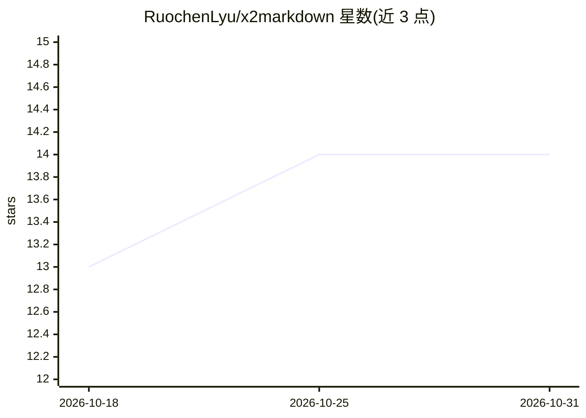

# RuochenLyu/x2markdown

⭐ 14 · JavaScript · MIT · 推送 2026-06-05 · [GitHub](https://github.com/RuochenLyu/x2markdown) · [官网](https://chromewebstore.google.com/detail/x2markdown/acljfllclafamkhdjjkldogcadfbigmo) · 个人维护 · 中文 README

**一键把网页或 X 帖子转为干净 Markdown 的 Chrome 扩展**

Manifest V3 Chrome 扩展：在任意 http/https 页面右键即可复制为 Markdown，通用页面优先复制选区、无选区时用内置 Mozilla Readability 提取正文；在 x.com 上提供帖文（作者/时间/链接/正文/引用帖/图片链接）、连续自回复串与长文的专属导出，时间线截断帖会先点击 Show more 再提取。面向需要向 LLM 对话、知识库或笔记工具喂入结构化文本的用户。限制：不导出完整会话与视频/投票，不绕过登录墙/付费墙，不支持 twitter.com，X 的 DOM 变更可能导致提取逻辑失效。以 MIT 开源作为展示项目，默认不接受外部 PR。

## 筛选速览

| 维度 | 判定 | 备注 |
|---|---|---|
| AI 角色 | `ai-enhanced` | 去掉 AI 部分产品仍成立 |
| 许可风险 | `permissive` | MIT |
| 部署形态 | `None` |  |
| 模型依赖 | — | README 未给出锁定关系 |
| 硬件要求 | — | 无带数字的原话,不猜 |
| 安装摩擦 | `low` | 无编译、无系统依赖或容器化 |
| 成熟度 | — | 结构信号不足 |

## 能力要点

- 任意页面右键复制为 Markdown，选区优先、无选区回退 Readability 提取正文
- X 帖文导出含作者/时间/链接/正文/引用帖/图片链接
- status 详情页可按序导出主帖加顶部连续自回复串
- 中英文界面随 Chrome UI 语言切换

## 适用场景

- 把网页正文复制进 LLM 对话前先整理成结构化 Markdown
- 将 X 帖子或长文归档到 Markdown 笔记/知识库
- 把文章或帖子保存为 .md 文件留档

## 场景标签

`网页抓取` · 领域:效率与自动化

## 证据(README 行号)

> L15: `x2markdown` is a Chrome extension. Right-click any page and it turns into clean Markdown — paste it into an LLM ch
> L27: LLMs handle well-structured text best. But getting a browser page into that shape is surprisingly fiddly:
> L33: Whether you're pasting into a chat window, feeding a personal knowledge base, or archiving research as Markdown, `x

## 星数曲线

2026-10-18 13 → 2026-10-31 14（+1）

---
*卡片 v1 · prompt 1.4 · 生成 2026-10-31 · 置信度 high · 依据 README sha `c1f05e778640` · [字段定义](../../DATASET.md)*
