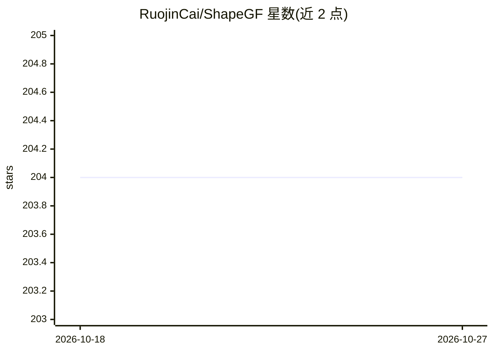

# RuojinCai/ShapeGF

⭐ 204 · Python · MIT · 推送 2026-04-04 · [GitHub](https://github.com/RuojinCai/ShapeGF) · [官网](http://www.cs.cornell.edu/~ruojin/ShapeGF/) · 组织维护

**论文实现：学习梯度场从点云生成三维形状**

ECCV 2020 论文 Learning Gradient Fields for Shape Generation 的 PyTorch 官方实现。方法为将点云视为三维点分布的采样，通过随机梯度上升将采样点移向高密度区域，模型直接预测对数密度场的梯度，训练目标改编自基于分数的生成模型；可输出点云自编码与生成结果并提取隐式表面。提供 conda 环境配置、预训练模型（Hugging Face）、单机多卡训练脚本，两阶段流程：先训练自编码器，再训练 l-GAN 建模形状分布。数据集按 PointFlow 说明配置（ShapeNet）。

## 筛选速览

| 维度 | 判定 | 备注 |
|---|---|---|
| AI 角色 | `ai-native` | 本体是模型或模型工具 |
| 许可风险 | `permissive` | MIT |
| 部署形态 | `None` |  |
| 模型依赖 | — | README 未给出锁定关系 |
| 硬件要求 | — | 无带数字的原话,不猜 |
| 安装摩擦 | `medium` | 含编译或系统依赖之一 |
| 成熟度 | — | 结构信号不足 |

## 能力要点

- 预测对数密度场梯度，以随机梯度上升生成点云
- 两阶段训练：自编码器 + l-GAN 形状分布建模
- 支持单 GPU 与单机多 GPU（DistributedDataParallel）训练
- 提供 Hugging Face 预训练模型与 CD/EMD/JSD 等评测脚本

## 适用场景

- 复现论文的点云自编码与生成实验
- 在 ShapeNet 类别（飞机/椅子/汽车等）上训练形状生成模型
- 从生成点云提取隐式表面

## 场景标签

`模型训练` · 领域:训练与推理

## 证据(README 行号)

> L3: This repository contains a PyTorch implementation of the paper:
> L23: In this work, we propose a novel technique to generate shapes from point cloud data. A point cloud can be viewed as

## 星数曲线

2026-10-18 204 → 2026-10-27 204（+0）

---
*卡片 v1 · prompt 1.4 · 生成 2026-10-22 · 置信度 high · 依据 README sha `0118e4edfc55` · [字段定义](../../DATASET.md)*
