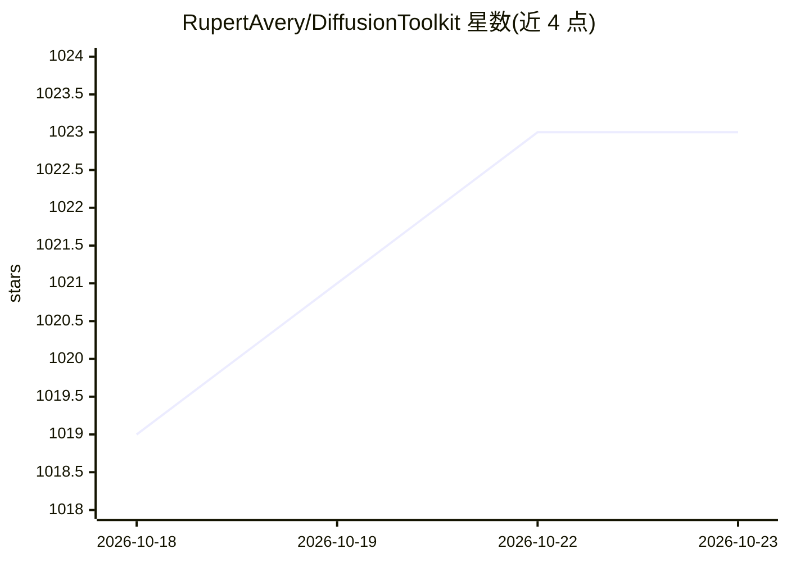

# RupertAvery/DiffusionToolkit

⭐ 1,023 · C# · MIT · 推送 2026-02-27 · [GitHub](https://github.com/RupertAvery/DiffusionToolkit) · 个人维护

**AI 生成图像的元数据索引与查看器（Windows 桌面应用）**

面向 AI 图像生成用户的 WPF 桌面应用：扫描本地 JPG/PNG/WebP/MP4 等格式图像与视频，读取 PNGInfo 等元数据（支持 AUTOMATIC1111、InvokeAI、NovelAI、Fooocus 等多种生成器格式），将提示词等信息入库建立索引，提供按元数据搜索、标签（收藏/评分/NSFW）、排序、相册、文件夹视图与拖拽整理功能。无元数据的图像也可使用评分与相册功能。当前仅运行于 Windows，发布 zip 包需 .NET 6 Desktop Runtime，源码构建需 Visual Studio 与 .NET SDK。

## 筛选速览

| 维度 | 判定 | 备注 |
|---|---|---|
| AI 角色 | `ai-enhanced` | 去掉 AI 部分产品仍成立 |
| 许可风险 | `permissive` | MIT |
| 部署形态 | `None` |  |
| 模型依赖 | — | README 未给出锁定关系 |
| 硬件要求 | — | 无带数字的原话,不猜 |
| 安装摩擦 | `medium` | 含编译或系统依赖之一 |
| 成熟度 | — | 结构信号不足 |

## 能力要点

- 扫描图像/视频并将提示词等元数据（PNGInfo）存储索引
- 支持 AUTOMATIC1111、InvokeAI、NovelAI、Fooocus 等多种元数据格式
- 标签体系：收藏、1-10 评分、NSFW（含关键词自动打标与模糊化）
- 按元数据搜索、按日期/美学分/评分排序，相册与拖拽整理

## 适用场景

- 整理和搜索不断增长的 AI 生成图像收藏
- 查看图像内嵌的提示词与生成参数
- 对图像打分、标记 NSFW 并归入相册管理

## 场景标签

 · 领域:AI 图像管理/桌面工具

## 证据(README 行号)

> L3: Diffusion Toolkit is an image metadata-indexer and viewer for AI-generated images. It aims to help you organize, sea
> L38: * Scan images and videos, store and index prompts and other metadata (PNGInfo)
> L74: * AUTOMATIC1111 and A1111-compatible metadata such as

## 星数曲线

2026-10-18 1,019 → 2026-10-23 1,023（+4）

---
*卡片 v1 · prompt 1.4 · 生成 2026-10-21 · 置信度 high · 依据 README sha `7361c76ea2a5` · [字段定义](../../DATASET.md)*
