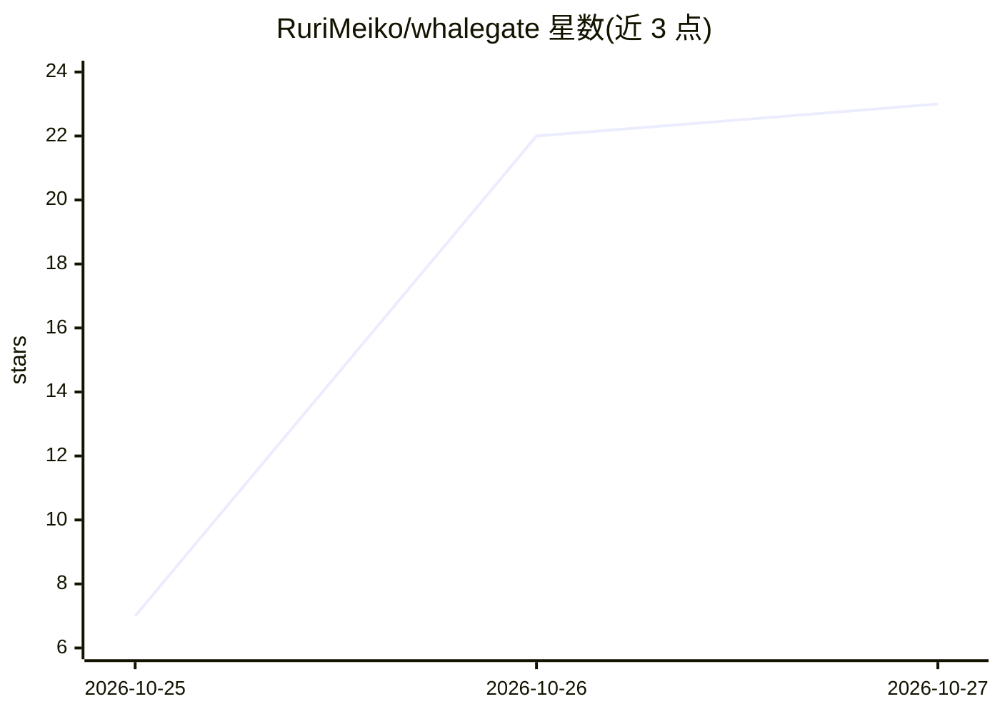

# RuriMeiko/whalegate

⭐ 23 · Rust · MIT · 推送 2026-10-26 · [GitHub](https://github.com/RuriMeiko/whalegate) · 个人维护

**把 DeepSeek 网页会话封装为 OpenAI 兼容 API 的 Rust 网关**

用 Rust 编写的自托管网关：将用户自己的 chat.deepseek.com 网页会话转换为标准 OpenAI 风格的 /v1/chat/completions 端点。提供账号池（最少繁忙调度、并发上限、冷却）、跨账号故障转移、SSE 流式输出、图像输入，以及通过 DSML 格式模拟的工具调用（tool_choice、JSON Schema 校验、修复重试）。通过 CDP 从 Chrome 捕获并定期刷新会话 Cookie，内置 DeepSeekHashV1 工作量证明求解器。README 声明仅供学习与研究，自动化网页端可能违反 DeepSeek 服务条款，建议正式用途使用官方付费 API。

## 筛选速览

| 维度 | 判定 | 备注 |
|---|---|---|
| AI 角色 | `ai-ecosystem` | LLM/agent 周边工具 |
| 许可风险 | `permissive` | MIT |
| 部署形态 | `desktop` | 安装包/桌面程序 |
| 模型依赖 | locked-api |  |
| 硬件要求 | — | 无带数字的原话,不猜 |
| 安装摩擦 | `medium` | 含编译或系统依赖之一 |
| 成熟度 | — | 结构信号不足 |

## 能力要点

- OpenAI 兼容端点，支持 SSE 流式、usage 统计与 cached_tokens
- 模拟工具调用：Schema 校验、类型强制转换、修复重试、parallel_tool_calls
- 账号池调度与最多 3 次尝试的故障转移
- 预编译静态二进制（Linux x86_64/arm64、macOS、Windows）与一键安装脚本

## 适用场景

- 让 Cline、Continue、OpenAI SDK 等客户端把网页会话当作标准 API 使用
- 在自己的账号上做协议研究和个人自动化实验
- 通过状态化会话复用让多步 agent 循环只发送新增消息

## 场景标签

`模型网关` · 领域:Agent 开发

## 证据(README 行号)

> L9: **whalegate** turns your own `chat.deepseek.com` web sessions into a standard OpenAI-style `/v1/chat/completions` en
> L20: |🔌 **OpenAI-compatible**|`POST /v1/chat/completions` (stream and non-stream) and `GET /v1/models`. Responses use th

## 星数曲线

2026-10-25 7 → 2026-10-27 23（+16）

---
*卡片 v1 · prompt 1.4 · 生成 2026-10-27 · 置信度 mid · 依据 README sha `140bd3dde475` · [字段定义](../../DATASET.md)*
