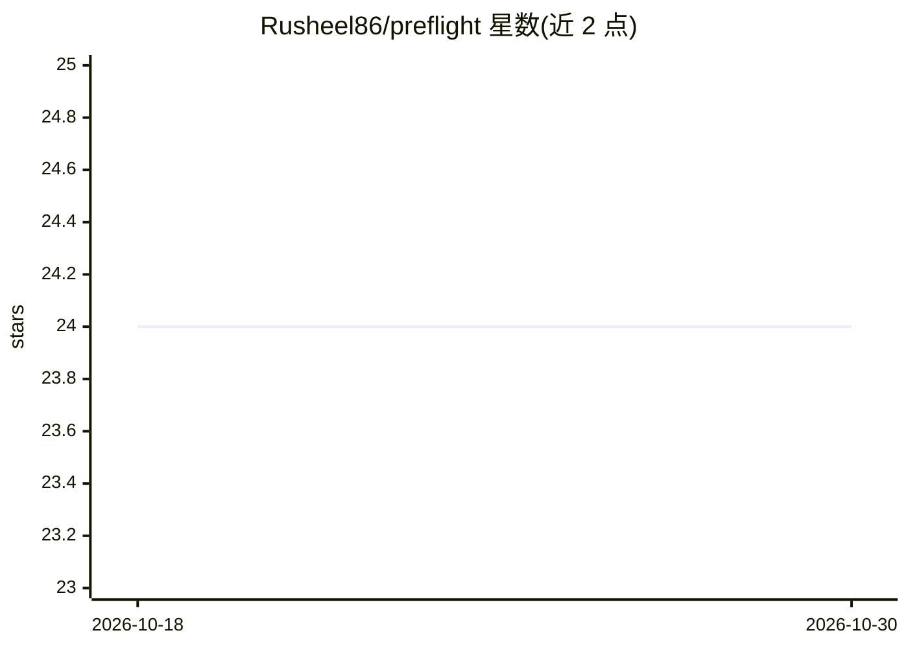

# Rusheel86/preflight

⭐ 24 · Python · MIT · 推送 2026-03-15 · [GitHub](https://github.com/Rusheel86/preflight) · 个人维护

**PyTorch 训练前的预检工具：训练开始前捕捉数据与模型缺陷**

面向 PyTorch 用户的训练前校验 CLI：用户以 Python 文件暴露 dataloader（可选 model/loss/val-dataloader），运行 preflight 即执行 10 项检查，分 FATAL/WARN/INFO 三级，覆盖 NaN/Inf 检测、train/val 标签泄漏、形状不匹配、死梯度、VRAM 估算、类不平衡等。FATAL 失败退出码为 1，可接入 GitHub Actions 自动阻断 CI；支持 .preflight.toml 配置阈值与 JSON 输出。README 明确声明不替代单元测试、不保证模型正确、不运行完整训练循环。

## 筛选速览

| 维度 | 判定 | 备注 |
|---|---|---|
| AI 角色 | `ai-ecosystem` | LLM/agent 周边工具 |
| 许可风险 | `permissive` | MIT |
| 部署形态 | `library` | 以包/库形式分发 |
| 模型依赖 | — | README 未给出锁定关系 |
| 硬件要求 | — | 无带数字的原话,不猜 |
| 安装摩擦 | `low` | 无编译、无系统依赖或容器化 |
| 成熟度 | — | 结构信号不足 |

## 能力要点

- 10 项检查、FATAL/WARN/INFO 三级严重度
- FATAL 失败退出码 1，可自动阻断 CI 构建
- GitHub Actions 一步集成，已上架 GitHub Marketplace
- .preflight.toml 配置阈值，--format json 机器可读输出

## 适用场景

- 训练作业启动前快速排查数据集中的 NaN、泄漏与形状问题
- 在 CI 中作为训练前置门禁自动阻断有致命缺陷的构建
- 提交前估算模型峰值 VRAM 是否超出显存

## 场景标签

`MLOps` · 领域:训练与推理

## 证据(README 行号)

> L16: **preflight** is a pre-training validation tool you run in 30 seconds before starting any training job.
> L78: |Check|Severity|What it catches|

## 星数曲线

2026-10-18 24 → 2026-10-30 24（+0）

---
*卡片 v1 · prompt 1.4 · 生成 2026-10-27 · 置信度 high · 依据 README sha `b8d120e6a365` · [字段定义](../../DATASET.md)*
