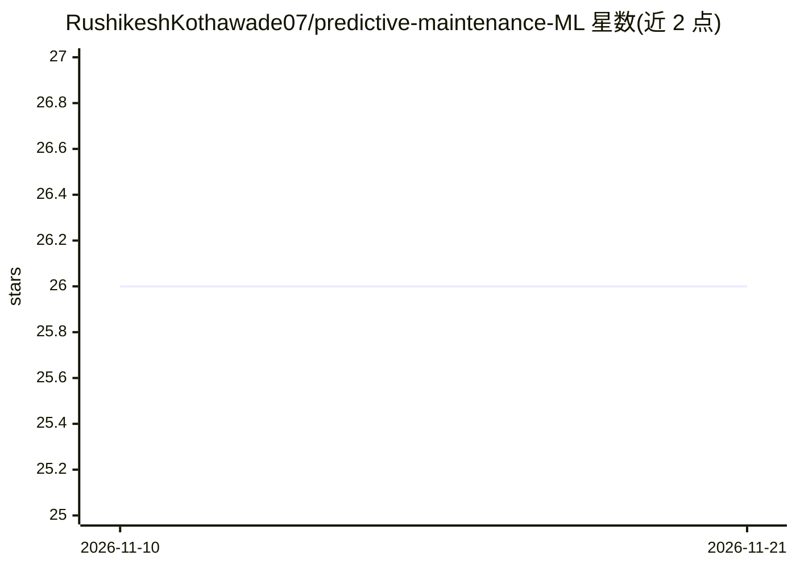

# RushikeshKothawade07/predictive-maintenance-ML

⭐ 26 · Jupyter Notebook · Apache-2.0 · 推送 2026-11-10 · [GitHub](https://github.com/RushikeshKothawade07/predictive-maintenance-ML) · [官网](https://predictive-maintenance-using-machine-learning.streamlit.app/) · 个人维护

**用随机森林预测机器是否故障的 Streamlit 演示应用**

基于 Streamlit 的网页应用：用户在表单中输入产品等级、空气温度、过程温度、转速、扭矩与刀具磨损等参数，随机森林分类器输出机器是否会故障的预测。训练数据为 10,000 条、14 特征的合成数据集（Kaggle），README 提醒数据集含两个目标列，勿将其作为特征以免数据泄漏。安装方式为 pip 安装依赖并克隆仓库后 streamlit run 运行，另有 Streamlit Cloud 部署版与 Google Colab 笔记本。作者声明仅用于教育与演示，不保证真实场景效果。

## 筛选速览

| 维度 | 判定 | 备注 |
|---|---|---|
| AI 角色 | `ai-native` | 本体是模型或模型工具 |
| 许可风险 | `permissive` | Apache-2.0 |
| 部署形态 | `library` | 以包/库形式分发 |
| 模型依赖 | — | README 未给出锁定关系 |
| 硬件要求 | — | 无带数字的原话,不猜 |
| 安装摩擦 | `low` | 无编译、无系统依赖或容器化 |
| 成熟度 | — | 结构信号不足 |

## 能力要点

- 随机森林分类器预测机器是否故障
- 表单输入 6 类传感器/工艺参数即可预测
- 提供 Streamlit Cloud 在线部署版与 Google Colab 笔记本
- 训练数据为 10,000 条 14 特征的合成数据集

## 适用场景

- 学习预测性维护的入门 ML 演示
- 输入工艺参数观察分类模型的预测表现
- 在 Colab 中复现训练与实验流程

## 场景标签

 · 领域:工业/预测性维护

## 证据(README 行号)

> L8: This application is designed to predict machine failure for predictive maintenance using machine learning. It utiliz
> L53: 3. Click on the "Predict Failure" button to make a prediction.
> L69: The predictive model used in this application is a Random Forest Classifier, a powerful ensemble learning method th

## 星数曲线

2026-11-10 26 → 2026-11-21 26（+0）

---
*卡片 v1 · prompt 1.4 · 生成 2026-11-18 · 置信度 high · 依据 README sha `3318211da031` · [字段定义](../../DATASET.md)*
