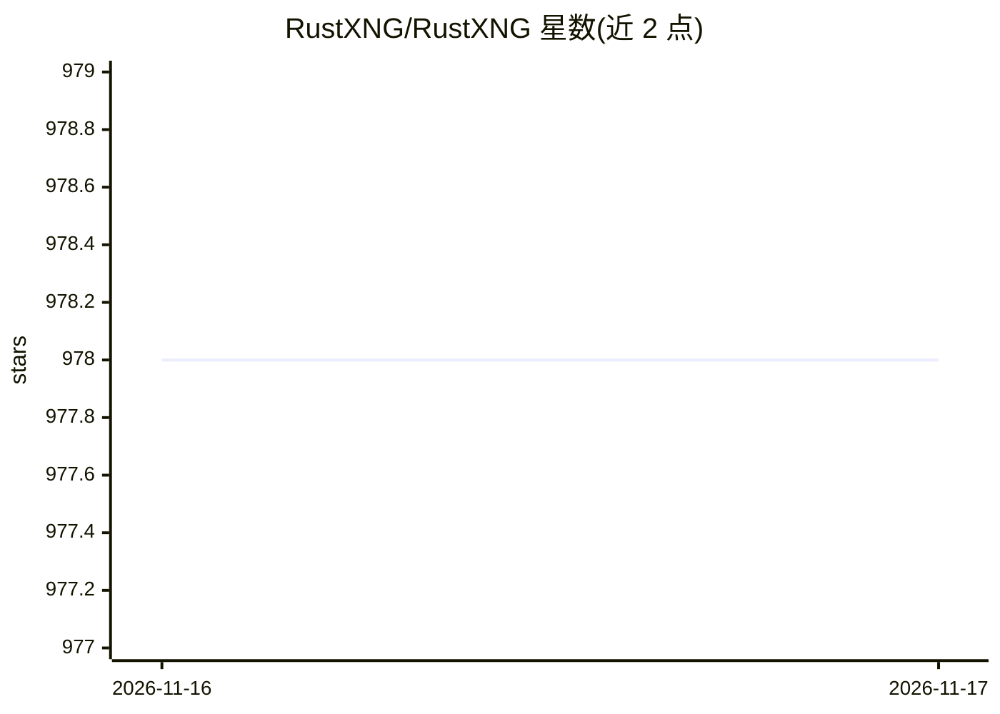

# RustXNG/RustXNG

⭐ 978 · Rust · AGPL-3.0 · 推送 2026-11-16 · [GitHub](https://github.com/RustXNG/RustXNG) · 个人维护 · 中文 README

**面向 AI agent 的自托管元搜索与 grounding 引擎（基于 SearXNG）**

用 Rust 编写的自托管元搜索引擎，聚合外部搜索提供商的结果，可通过 JSON API 或内置 MCP 服务器供 AI agent 调用，提供 search 与 read_page 两个只读工具以获取搜索结果和页面文本。不维护全网索引，可用 rustxng-index 构建所选站点的本地索引并导入 Wikipedia dump。搜索来源按 Standard/Clean/Full 三种 profile 组织；页面抓取遵循 robots.txt 并阻止非公开地址。提供二进制、Cargo 安装与 Docker 镜像，PDF 提取需 Poppler、JS 渲染需可选 Firefox 渲染器。AGPL-3.0-or-later 许可。

## 筛选速览

| 维度 | 判定 | 备注 |
|---|---|---|
| AI 角色 | `ai-ecosystem` | LLM/agent 周边工具 |
| 许可风险 | `dual` | AGPL-3.0 |
| 部署形态 | `desktop` | 安装包/桌面程序 |
| 模型依赖 | — | README 未给出锁定关系 |
| 硬件要求 | — | 无带数字的原话,不猜 |
| 安装摩擦 | `low` | 无编译、无系统依赖或容器化 |
| 成熟度 | — | 结构信号不足 |

## 能力要点

- 内置 MCP 服务器暴露 search 与 read_page 两个只读工具
- Standard/Clean/Full 三种搜索 profile，Clean 仅查本地索引
- 页面抓取遵循 robots.txt (RFC 9309) 并阻止非公开地址访问
- 支持 tokenizer (cl100k_base/o200k_base) 与 max_payload_tokens 精确预算

## 适用场景

- 为 AI agent 提供带页面文本读取能力的搜索工具
- 通过 Clean profile 做仅本地索引的离线搜索
- 自托管部署搜索服务供 agent 经 JSON API 调用

## 场景标签

 · 领域:搜索基础设施/AI agent 工具

## 证据(README 行号)

> L7: RustXNG is a self-hosted metasearch engine written in Rust, based on SearXNG. It combines results from external sear
> L43: Start the built-in MCP server:

## 星数曲线

2026-11-16 978 → 2026-11-17 978（+0）

---
*卡片 v1 · prompt 1.4 · 生成 2026-11-17 · 置信度 high · 依据 README sha `81c839dfd6bf` · [字段定义](../../DATASET.md)*
