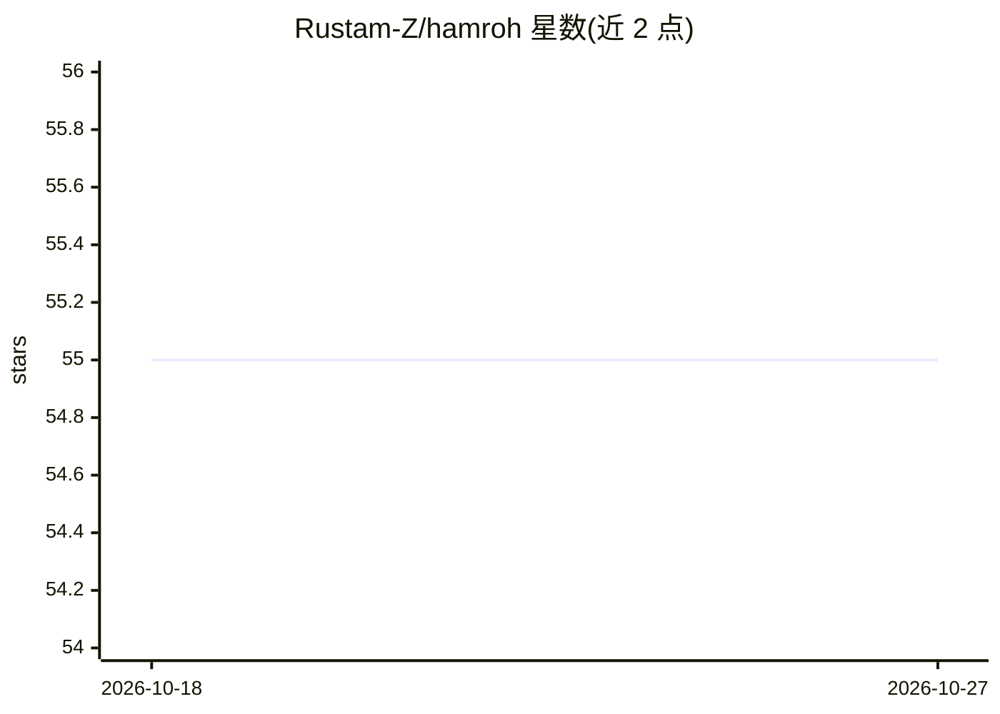

# Rustam-Z/hamroh

⭐ 55 · Python · MIT · 推送 2026-10-18 · [GitHub](https://github.com/Rustam-Z/hamroh) · 个人维护

**自托管持久 AI 伴侣框架：在 Telegram 上运行自己的 agent**

hamroh 是一个在 Telegram 上运行持久 AI 伴侣/助手的 agent harness 框架，用户完全拥有记忆文件、技能手册、MCP 连接与日志。功能包括群聊参与、自反思并提出新规则、后台定时任务、跨重启的文件记忆、MCP 扩展接入 GitHub/Jira 等。运行依赖 Claude Code CLI 与 Docker（或 Python 3.11+），通过 Claude 订阅或 API 认证。引擎一次处理一个对话轮次，长任务会阻塞其他会话。限制：不能生成图片、处理语音/视频/贴纸或主持群组。

## 筛选速览

| 维度 | 判定 | 备注 |
|---|---|---|
| AI 角色 | `ai-ecosystem` | LLM/agent 周边工具 |
| 许可风险 | `permissive` | MIT |
| 部署形态 | `self-host` | docker 或自建部署 |
| 模型依赖 | — | README 未给出锁定关系 |
| 硬件要求 | — | 无带数字的原话,不猜 |
| 安装摩擦 | `low` | 无编译、无系统依赖或容器化 |
| 成熟度 | — | 结构信号不足 |

## 能力要点

- 文件记忆跨重启持久化，git 追踪可人工整理
- 自反思机制：复盘错误并提出新规则供所有者批准
- 通过 MCP 接入 GitHub/Jira/邮件/日历等外部工具
- Docker compose 或 uv + Python 3.11+ 两种运行方式

## 适用场景

- 在 Telegram 群里部署一个自己控制的持久 AI 助手
- 让 AI 定时执行后台研究任务并监控关注的事项
- 通过技能手册与 MCP 工具按需扩展助手能力

## 场景标签

`AI 助手` · 领域:对话与助手

## 证据(README 行号)

> L3:  hamroh is a framework for running your own persistent AI companion on Telegram — one you fully own, control, can ex
> L7: **hamroh** runs a persistent AI assistant in your Telegram. Not a chatbot — an agent that has memory, runs scheduled
> L97: Telegram  →  Engine (buffer + debounce)  →  Claude worker  →  claude process

## 星数曲线

2026-10-18 55 → 2026-10-27 55（+0）

---
*卡片 v1 · prompt 1.4 · 生成 2026-10-24 · 置信度 high · 依据 README sha `ce4b439aecb4` · [字段定义](../../DATASET.md)*
