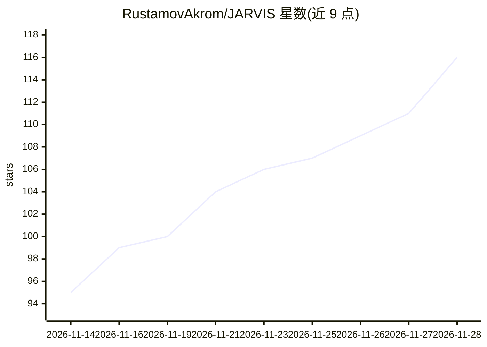

# RustamovAkrom/JARVIS

⭐ 116 · Python · MIT · 推送 2026-11-26 · [GitHub](https://github.com/RustamovAkrom/JARVIS) · 个人维护

**模块化桌面 AI 助手：语音、记忆与桌面自动化**

跨平台桌面 AI 助手，将实时语音交互、可配置 AI 引擎、持久记忆、桌面操作工具、插件与外部集成整合在一个 PyQt6 应用中。架构上模型只发起工具请求，本地运行时负责校验与执行，带权限与确认门控。支持 Gemini Live 引擎与可组合 STT/LLM/TTS 管线，可接本地模型服务器实现全本地语音工作流。稳定打包版本目前仅覆盖 Windows，macOS/Linux 需从源码运行。

## 筛选速览

| 维度 | 判定 | 备注 |
|---|---|---|
| AI 角色 | `ai-native` | 本体是模型或模型工具 |
| 许可风险 | `permissive` | MIT |
| 部署形态 | `desktop` | 安装包/桌面程序 |
| 模型依赖 | local-ok | 支持本地模型 |
| 硬件要求 | — | 无带数字的原话,不猜 |
| 安装摩擦 | `low` | 无编译、无系统依赖或容器化 |
| 成熟度 | — | 结构信号不足 |

## 能力要点

- 本地 Hey JARVIS 唤醒词检测与实时语音对话（Gemini Live）
- 模型提议、本地运行时校验执行的工具调用生命周期
- MCP STDIO/HTTP/SSE、OAuth 连接与原生适配器（GitHub、Google Calendar、Telegram）
- 持久对话与长期记忆分离存储，可搜索管理

## 适用场景

- 通过语音和文本与桌面助手交互，控制应用与系统设置
- 接入 Ollama 等本地模型构建全本地语音助手
- 连接 GitHub、日历等外部服务并让助手调用其工具
- 在项目工作区中让助手读取、解释、修改并运行代码

## 场景标签

`AI 助手` `语音 Agent` `Agent 记忆` `GUI 自动化` · 领域:Agent 开发

## 证据(README 行号)

> L6:  A modular desktop AI assistant that brings voice, AI models, memory, automation and connected services into one wor
> L26: JARVIS is a cross-platform desktop AI assistant built to connect conversational AI with the user's desktop environm
> L171: Providers are selected through the Engine & Providers settings. Depending on the provider, the pipeline can use lo

## 星数曲线

2026-11-14 95 → 2026-11-28 116（+21）

---
*卡片 v1 · prompt 1.4 · 生成 2026-11-28 · 置信度 high · 依据 README sha `c75afd52cb18` · [字段定义](../../DATASET.md)*
