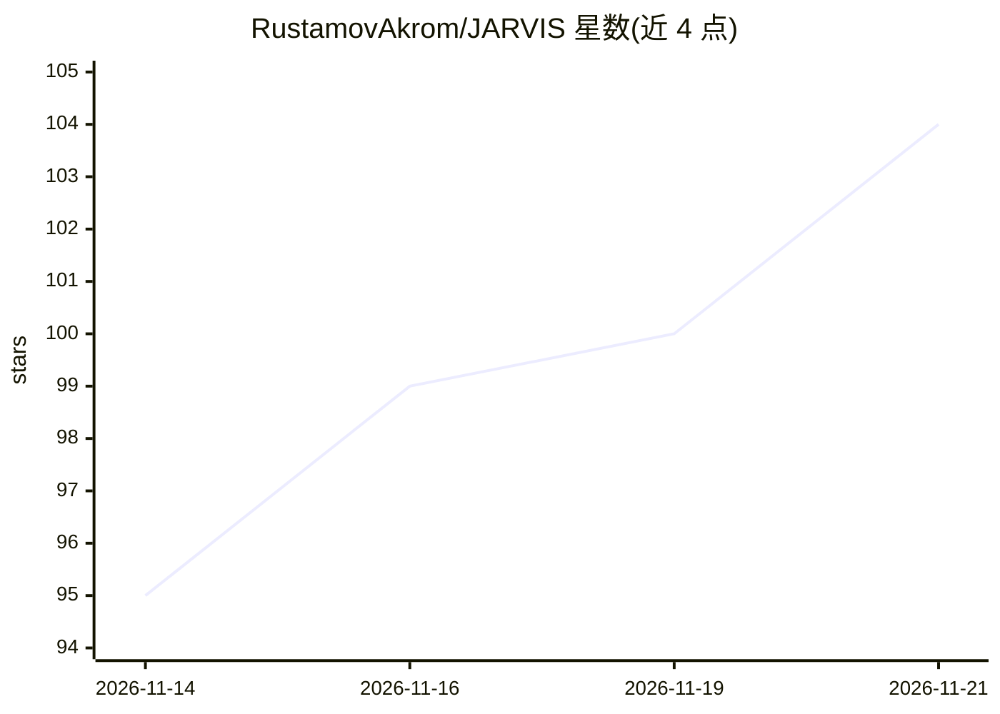

# RustamovAkrom/JARVIS

⭐ 104 · Python · NOASSERTION · 推送 2026-11-20 · [GitHub](https://github.com/RustamovAkrom/JARVIS) · 个人维护

**桌面端语音 AI 助手：对话、电脑工具与本地记忆一体**

面向个人用户的桌面 AI 助手：默认用 Gemini Live 进行语音对话（也可另行配置语音识别、语言模型、语音合成三级流水线，支持 Ollama/LM Studio/llama.cpp/vLLM 等本地服务，需单独安装）。内置 HUD 界面、项目文件只读访问、浏览器控制、可选的屏幕与鼠标键盘操作、本地记忆与提醒等。提供 18 个可选插件（Excel 写入、Obsidian、Telegram 远控等），插件以当前用户权限运行、无沙箱。从 Python 源码运行，需 Python 3.14+ 与 Gemini API key。

## 筛选速览

| 维度 | 判定 | 备注 |
|---|---|---|
| AI 角色 | `ai-native` | 本体是模型或模型工具 |
| 许可风险 | `none` | NOASSERTION |
| 部署形态 | `desktop` | 安装包/桌面程序 |
| 模型依赖 | local-ok | 支持本地模型 |
| 硬件要求 | — | 无带数字的原话,不猜 |
| 安装摩擦 | `medium` | 含编译或系统依赖之一 |
| 成熟度 | — | 结构信号不足 |

## 能力要点

- 语音/打字对话，Gemini Live 或可配置的三级本地/托管流水线
- 可选屏幕与鼠标键盘控制，权限分立开关，敏感操作需确认
- 本地记忆存储选定事实与会话摘要并可检索
- 18 个可选插件（Excel、Obsidian、Telegram 远控、OSINT 等）

## 适用场景

- 用语音或文字让助手操作电脑、搜索网页、管理提醒
- 在选定的项目工作区内让 AI 检查文件并配合内置编辑器/终端工作
- 接本地模型服务后在自己机器上运行语言模型部分

## 场景标签

`AI 助手` `语音 Agent` `GUI 自动化` · 领域:效率与自动化

## 证据(README 行号)

> L10: JARVIS is a desktop AI assistant built around voice, a customizable HUD, and practical tools for everyday computer 
> L17: - **Choose how AI runs:** use Gemini Live or configure separate speech-to-text, language-model, and text-to-speech 

## 星数曲线

2026-11-14 95 → 2026-11-21 104（+9）

---
*卡片 v1 · prompt 1.4 · 生成 2026-11-17 · 置信度 mid · 依据 README sha `0d1d49c2482a` · [字段定义](../../DATASET.md)*
