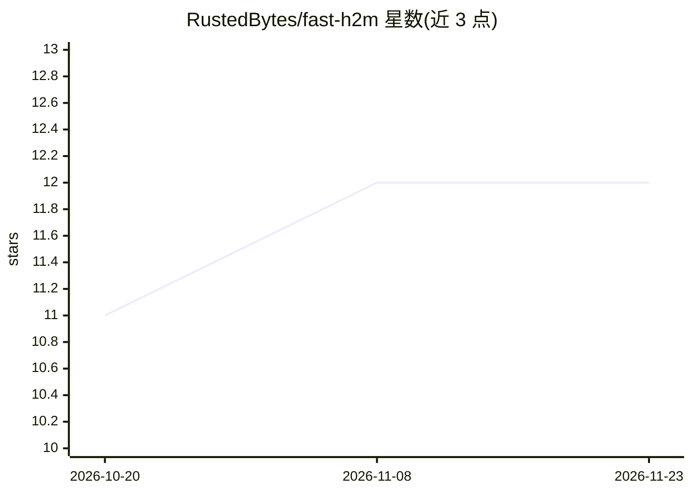

# RustedBytes/fast-h2m

⭐ 12 · HTML · MIT · 推送 2026-09-28 · [GitHub](https://github.com/RustedBytes/fast-h2m) · 组织维护

**LLM 数据准备场景的 Rust 高速 HTML 转 Markdown 库**

以 Rust 编写的 HTML 到 Markdown 转换库，是 html-to-markdown 的分支，提供 Crates.io 的 fast_h2m crate 与 PyPI 的 Python 绑定（pyo3）。convert() 返回含正文、元数据、表格的结构化 ConversionResult；支持 Builder 配置、保留指定 HTML 标签、预处理网页抓取、图片提取（feature 开关）、自定义 visitor，以及面向吞吐的 FastDom 与 mdream 两种精简模式；MarkdownStreamProcessor 支持分块流式转换。asm-tl feature 提供汇编后端，仅支持 x86-64/AArch64/RISC-V Linux 与 x86-64 Windows MSVC。

## 筛选速览

| 维度 | 判定 | 备注 |
|---|---|---|
| AI 角色 | `ai-ecosystem` | LLM/agent 周边工具 |
| 许可风险 | `permissive` | MIT |
| 部署形态 | `library` | 以包/库形式分发 |
| 模型依赖 | — | README 未给出锁定关系 |
| 硬件要求 | — | 无带数字的原话,不猜 |
| 安装摩擦 | `low` | 无编译、无系统依赖或容器化 |
| 成熟度 | — | 结构信号不足 |

## 能力要点

- Rust 实现，提供 Python 绑定（PyPI 发布）
- FastDom、mdream、asm_tl 三种转换后端可按次选择
- MarkdownStreamProcessor 支持分块流式转换
- 输出结构化结果：正文、元数据、表格、visitor 输出

## 适用场景

- 把网页 HTML 批量转换为 Markdown 喂给 LLM 流水线
- 需要流式转换大文档的场景
- 提取网页表格与元数据做结构化处理

## 场景标签

`文档解析` `网页抓取` · 领域:效率与自动化

## 证据(README 行号)

> L8: High-performance HTML to Markdown converter written in Rust.
> L211: kreuzberg-dev/html-to-markdown

## 星数曲线

2026-10-20 11 → 2026-11-23 12（+1）

---
*卡片 v1 · prompt 1.4 · 生成 2026-11-18 · 置信度 mid · 依据 README sha `8c4a6f8fcb94` · [字段定义](../../DATASET.md)*
