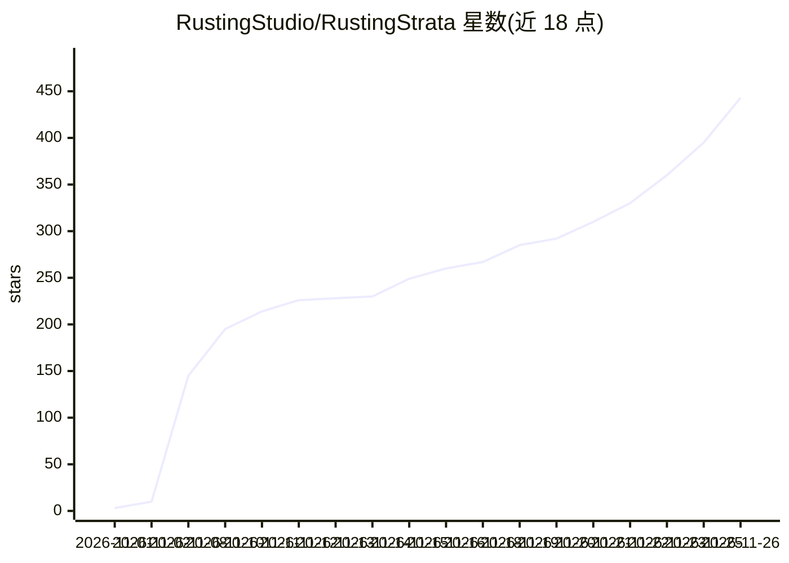

# RustingStudio/RustingStrata

⭐ 443 · Rust · NOASSERTION · 推送 2026-11-25 · [GitHub](https://github.com/RustingStudio/RustingStrata) · 个人维护

**纯 Rust 的 GGUF LLM 推理引擎：VRAM 装不下的 MoE 也能跑**

面向 GGUF 格式 MoE 模型的纯 Rust 推理引擎：CUDA 内核经 NVRTC 运行时编译，同一套内核可运行于 Vulkan，无 C++ 构建步骤、不依赖 ggml。放不进 VRAM 的专家同时在 CPU 上运行，专家放置随路由自适应。支持 Qwen3 系列、DeepSeek-V4.1-Flash、GLM-5.3-Flash、Gemma 4 等架构，内置 OpenAI 与 Anthropic 兼容 API 服务器、MTP 草稿、LoRA 与图像输入。Linux/Windows 提供二进制下载，或用 cargo 构建。

## 筛选速览

| 维度 | 判定 | 备注 |
|---|---|---|
| AI 角色 | `ai-ecosystem` | LLM/agent 周边工具 |
| 许可风险 | `none` | NOASSERTION |
| 部署形态 | `desktop` | 安装包/桌面程序 |
| 模型依赖 | — | README 未给出锁定关系 |
| 硬件要求 | — | 无带数字的原话,不猜 |
| 安装摩擦 | `high` | 编译与系统依赖俱全 |
| 成熟度 | — | 结构信号不足 |

## 能力要点

- 纯 Rust 实现：NVRTC 运行时编译 CUDA 内核，同一内核运行于 Vulkan
- 专家放置自适应：放不进 VRAM 的专家在 CPU 上与 GPU 并行运行
- 内置 OpenAI/Anthropic 兼容服务器，支持 MCP 工具与 LoRA 适配器
- 针对 MoE 模型：模型超出 VRAM 时仍可运行

## 适用场景

- 在显存有限的消费级 GPU 上运行大型 MoE 模型
- 为 Open WebUI/SillyTavern 等应用提供本地 OpenAI 兼容端点
- 对同一 GGUF 文件与 llama.cpp 对比推理速度

## 场景标签

`推理引擎` · 领域:训练与推理

## 证据(README 行号)

> L5: A pure-Rust inference engine for GGUF models, built for MoE models that do not fit in VRAM. The CUDA kernels are
> L53: Run `rustingstrata` with no arguments (double-click `rustingstrata.exe` on Windows). It starts a server on
> L55: your models folder. Any app that takes an OpenAI-compatible address (Open WebUI, Jan, SillyTavern, code editors) ca

## 星数曲线

2026-11-01 3 → 2026-11-26 443（+440）

---
*卡片 v1 · prompt 1.4 · 生成 2026-11-25 · 置信度 high · 依据 README sha `1fe4d7453166` · [字段定义](../../DATASET.md)*
