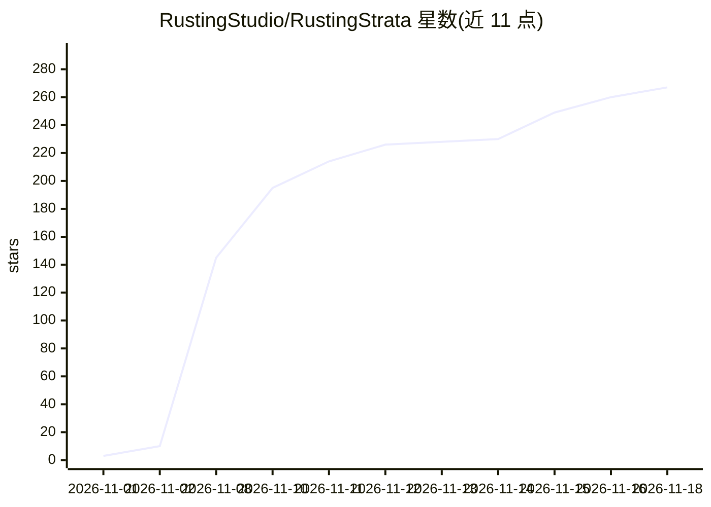

# RustingStudio/RustingStrata

⭐ 267 · Rust · NOASSERTION · 推送 2026-11-17 · [GitHub](https://github.com/RustingStudio/RustingStrata) · 个人维护

**纯 Rust 的 Qwen GGUF 模型推理引擎，支持 CPU+GPU 混合专家**

以 Rust 实现的 GGUF 推理引擎，读取 Qwen3/3.5/3.6/3.8-Next、DeepSeek-V4.1-Flash、GLM-5.3-Flash 等架构的稠密与 MoE 模型。关键机制：CUDA 内核在运行时经 NVRTC 编译（无 C++ 构建步骤、无 ggml），同一套内核亦可在 Vulkan 后端运行；放不进显存的专家权重由 CPU 与 GPU 并行处理，专家放置随路由自适应；支持 MTP 投机解码。提供 OpenAI 与 Anthropic 兼容的 HTTP 服务器与聊天页面。限制：构建需 Rust 2024 edition，GPU 推理需 CUDA NVRTC 或 Vulkan 1.3 驱动之一；DeepSeek/GLM 路径仅支持贪心解码、不支持采样。

## 筛选速览

| 维度 | 判定 | 备注 |
|---|---|---|
| AI 角色 | `ai-ecosystem` | LLM/agent 周边工具 |
| 许可风险 | `none` | NOASSERTION |
| 部署形态 | `desktop` | 安装包/桌面程序 |
| 模型依赖 | locked-api |  |
| 硬件要求 | — | 无带数字的原话,不猜 |
| 安装摩擦 | `high` | 编译与系统依赖俱全 |
| 成熟度 | — | 结构信号不足 |

## 能力要点

- 运行时 NVRTC 编译 CUDA 内核，同一内核兼容 Vulkan（NVIDIA/AMD）
- CPU+GPU 混合专家执行，专家放置随路由自适应
- MTP 投机解码（--mtp），短提示解码最高约 160 tok/s（RTX 3060 实测）
- OpenAI 与 Anthropic 兼容服务器，附聊天页面与模型下载切换

## 适用场景

- 在单张 12 GB 显卡上本地运行超出显存容量的 MoE 模型
- 为 Open WebUI、Jan、SillyTavern 等应用提供 OpenAI 兼容的本地推理端点
- 用 bench/parity 工具对照 llama.cpp 做正确性与性能校验

## 场景标签

`推理引擎` · 领域:训练与推理

## 证据(README 行号)

> L3: A pure-Rust inference engine for Qwen GGUF models: Qwen3.5/3.6 (`qwen35moe`, `qwen35`), Qwen3-Next (`qwen3next`),
> L80: It starts a server on http://127.0.0.1:8080 and opens a chat page that downloads models from Hugging Face and switc
> L93: Without `--gpu` everything runs on the CPU reference, which is slow and meant for checking. Flags, the OpenAI and

## 星数曲线

2026-11-01 3 → 2026-11-18 267（+264）

---
*卡片 v1 · prompt 1.4 · 生成 2026-11-17 · 置信度 high · 依据 README sha `6dbff2b98894` · [字段定义](../../DATASET.md)*
