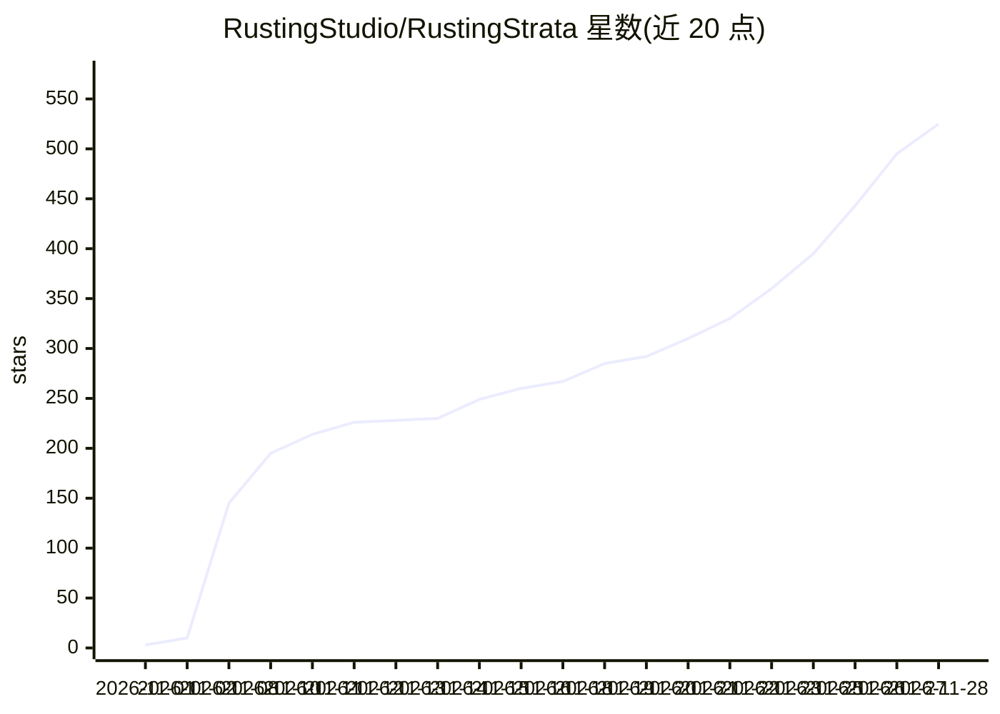

# RustingStudio/RustingStrata

⭐ 525 · Rust · NOASSERTION · 推送 2026-11-27 · [GitHub](https://github.com/RustingStudio/RustingStrata) · 个人维护

**面向消费者的纯 Rust LLM 推理引擎：VRAM 放不下的 MoE 模型本地推理**

用 Rust 编写的 GGUF 模型推理引擎，针对超出显存容量的 MoE 模型设计：CUDA 内核经 NVRTC 在运行时编译，同一内核可在 Vulkan 上运行；放不进显存的专家在 CPU 上与 GPU 工作并行执行，专家放置随路由情况自适应。提供终端聊天、网页聊天页、OpenAI/Anthropic 兼容 API 服务与批量并发解码。支持 Qwen3 系列、DeepSeek-V4.1-Flash、GLM-5.3-Flash 等架构。Windows/Linux 提供脚本安装与二进制，Arch 有 AUR 包，也可用 cargo 构建。

## 筛选速览

| 维度 | 判定 | 备注 |
|---|---|---|
| AI 角色 | `ai-ecosystem` | LLM/agent 周边工具 |
| 许可风险 | `none` | NOASSERTION |
| 部署形态 | `desktop` | 安装包/桌面程序 |
| 模型依赖 | locked-api |  |
| 硬件要求 | — | 无带数字的原话,不猜 |
| 安装摩擦 | `high` | 编译与系统依赖俱全 |
| 成熟度 | — | 结构信号不足 |

## 能力要点

- MoE 专家超显存时自动放置到 CPU 并与 GPU 并行执行
- CUDA 内核运行时经 NVRTC 编译，同一内核支持 Vulkan 1.3 回退
- serve --parallel 批量并发解码与 OpenAI/Anthropic 兼容端点
- 支持 MTP 草稿、LoRA 适配器、图像输入与 MCP 工具

## 适用场景

- 在 12 GB 显卡上运行超出显存容量的 MoE 大模型
- 给 Open WebUI、SillyTavern 等应用提供本地 OpenAI 兼容接口
- 本地部署 API 服务给多人并发使用

## 场景标签

`推理引擎` · 领域:训练与推理

## 证据(README 行号)

> L5: A pure-Rust inference engine for GGUF models, built for MoE models that do not fit in VRAM. The CUDA kernels are
> L70: Then `rustingstrata serve --gpu --open` opens the chat page, which downloads models, and `rustingstrata interface`
> L94: your models folder. Any app that takes an OpenAI-compatible address (Open WebUI, Jan, SillyTavern, code editors) ca

## 星数曲线

2026-11-01 3 → 2026-11-28 525（+522）

---
*卡片 v1 · prompt 1.4 · 生成 2026-11-28 · 置信度 high · 依据 README sha `8ca7764027fd` · [字段定义](../../DATASET.md)*
