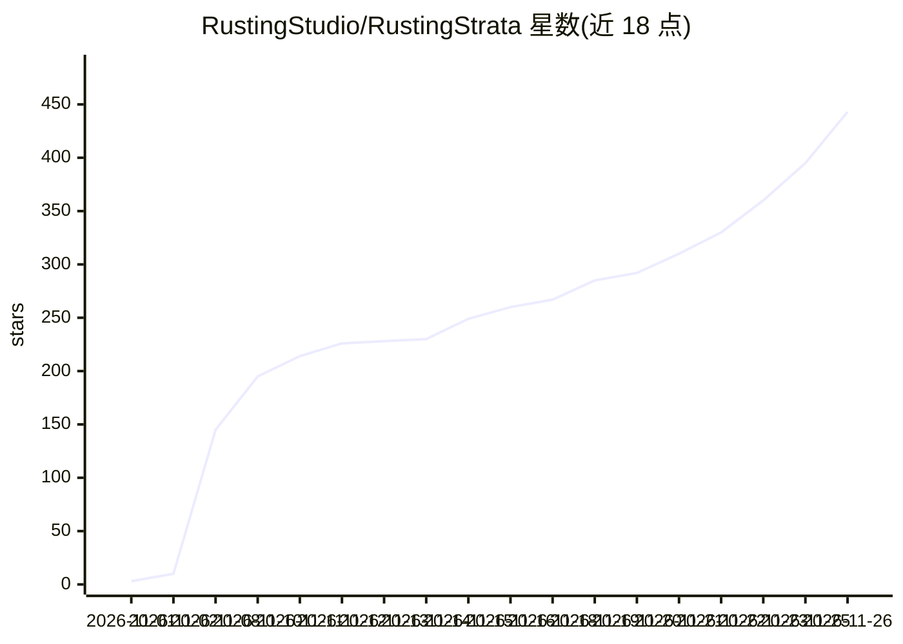

# RustingStudio/RustingStrata

⭐ 443 · Rust · NOASSERTION · 推送 2026-11-25 · [GitHub](https://github.com/RustingStudio/RustingStrata) · 组织维护

**纯 Rust 的 GGUF LLM 推理引擎：VRAM 放不下的 MoE 模型本地运行**

用 Rust 实现的 GGUF 模型推理引擎，面向无法完全装入显存的 MoE 模型：CUDA 内核经 NVRTC 在运行时编译，同一内核可跑 Vulkan，无 C++ 构建步骤与 ggml 依赖；装不进 VRAM 的专家放到 CPU 上与 GPU 工作并行，专家放置随路由自适应调整。提供 OpenAI 兼容与 Anthropic API 的服务端、聊天页面、MCP 工具、提示缓存、LoRA 与图像输入。支持 Qwen3 系列、DeepSeek-V4.1-Flash、GLM-5.3-Flash 等架构。README 以 RTX 3060 12GB 对比 llama.cpp 给出吞吐数字，并声明数字约有 30% 波动。

## 筛选速览

| 维度 | 判定 | 备注 |
|---|---|---|
| AI 角色 | `ai-ecosystem` | LLM/agent 周边工具 |
| 许可风险 | `none` | NOASSERTION |
| 部署形态 | `desktop` | 安装包/桌面程序 |
| 模型依赖 | locked-api |  |
| 硬件要求 | — | 无带数字的原话,不猜 |
| 安装摩擦 | `high` | 编译与系统依赖俱全 |
| 成熟度 | — | 结构信号不足 |

## 能力要点

- 专家放置自适应：VRAM 装不下的专家在 CPU 上运行，配合 GPU 并行
- CUDA 内核运行时经 NVRTC 编译，同一内核亦运行于 Vulkan 1.3
- 提供 OpenAI 兼容与 Anthropic API 服务端及 MCP 工具
- 支持 Qwen3、DeepSeek-V4.1-Flash、GLM-5.3-Flash、Gemma 4 等架构

## 适用场景

- 在 12GB 显存的消费级显卡上运行超出 VRAM 的 MoE 大模型
- 给 Open WebUI、SillyTavern 或代码编辑器提供本地 OpenAI 兼容接口
- 多用户并发场景下批量解码提供聊天服务

## 场景标签

`推理引擎` · 领域:训练与推理

## 证据(README 行号)

> L5: A pure-Rust inference engine for GGUF models, built for MoE models that do not fit in VRAM. The CUDA kernels are
> L70: Then `rustingstrata serve --gpu --open` opens the chat page, which downloads models, and `rustingstrata interface`
> L94: your models folder. Any app that takes an OpenAI-compatible address (Open WebUI, Jan, SillyTavern, code editors) ca

## 星数曲线

2026-11-01 3 → 2026-11-26 443（+440）

---
*卡片 v1 · prompt 1.4 · 生成 2026-11-26 · 置信度 high · 依据 README sha `870d1e3110b6` · [字段定义](../../DATASET.md)*
