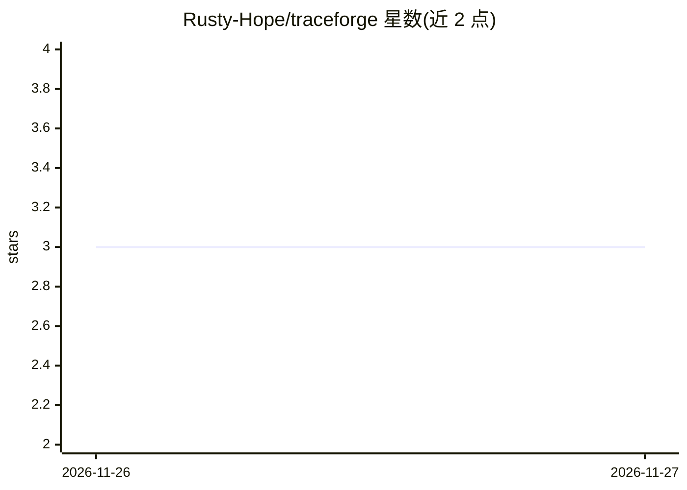

# Rusty-Hope/traceforge

⭐ 3 · Python · MIT · 推送 2026-11-18 · [GitHub](https://github.com/Rusty-Hope/traceforge) · 个人维护

**给运维团队做遥测异常检测与 LLM 后台事件分诊的引擎**

TraceForge 摄取遥测数据（自带 chaos 模拟器或通过 /api/ingest 接入真实服务事件），用本地 scikit-learn 模型（IsolationForest + 稳健 z 分数）做异常检测，将日志堆栈经 TF-IDF 聚类成规范化事件指纹，再由后台 LLM worker 通过 OpenRouter 对确认且去重后的新指纹生成结构化分诊（严重度、根因、修复步骤、补丁片段）。热点路径全部本地零 API 成本；提供 React 仪表盘、SSE 实时流、webhook 告警、Markdown 事后报告与人工反馈回路。空 API key 时退化为纯本地 ML 模式。

## 筛选速览

| 维度 | 判定 | 备注 |
|---|---|---|
| AI 角色 | `ai-native` | 本体是模型或模型工具 |
| 许可风险 | `permissive` | MIT |
| 部署形态 | `self-host` | docker 或自建部署 |
| 模型依赖 | locked-api |  |
| 硬件要求 | — | 无带数字的原话,不猜 |
| 安装摩擦 | `low` | 无编译、无系统依赖或容器化 |
| 成熟度 | — | 结构信号不足 |

## 能力要点

- 本地 scikit-learn 热点路径：异常检测、p95 漂移预测、爆炸半径关联、日志指纹聚类
- 后台 LLM 分诊仅处理统计确认且去重后的新指纹，SHA-256 缓存使重复指纹零 token 消耗
- 无聊天机器人界面，LLM 输出作为遥测元数据写入仪表盘，支持人工确认/否决反馈
- 提供 Webhook 告警、Markdown 事后报告导出与外部遥测批量摄取接口

## 适用场景

- 给微服务接入真实遥测，自动聚类噪音错误并生成根因分诊
- 用 chaos 注入演练故障检测与告警链路
- 在零 API 成本下运行本地 ML 异常检测（留空 API key）
- 故障后导出含 ML 证据与 LLM 分析的事后报告

## 场景标签

 · 领域:运维/可观测性

## 证据(README 行号)

> L13: TraceForge ingests telemetry (synthetic chaos or your real services), detects anomalies and clusters noisy stack tr
> L23: 1. **Zero chatbot UI.** The LLM never appears in the interface. No prompt box, no assistant panel — it is an invisi
> L43: |Hybrid anomaly detection — IsolationForest + per-feature robust z (median/MAD), adaptive threshold|`AnomalyDetecto

## 星数曲线

2026-11-26 3 → 2026-11-27 3（+0）

---
*卡片 v1 · prompt 1.4 · 生成 2026-11-26 · 置信度 high · 依据 README sha `addd86c16e52` · [字段定义](../../DATASET.md)*
